# ARCHITECTURE: the modules and how data moves through them

*Audit 2026-11, branch `audit/2026-11` off `main` at `5fd701d`. Written from the code: every module named here was read by an audit stream, and the import facts come from `web/scripts/audit/graph.mts` (see [FILE_MAP.md](FILE_MAP.md)). Where a doc says something else, the mismatch is listed at the end.*

## 1. One deployment, eight layers

HMI Copilot is one Next.js app (`web/`) on one Vercel project. There are no separate services. It has 364 source files: 117 server, 94 client and 153 shared.

| Layer | Where | What it owns |
|---|---|---|
| Pages and UI | `src/app/(workspace)`, `src/app/{signin,s,account,oauth}`, `src/components/**` | the workspace shell, start pane, canvas, inspector, chat, tags, history, export screens |
| Client state | `src/store/**` (Zustand) | the open project's screens, variables, bindings, alarms, composites, chat, undo stack, proposals, presence |
| The write path | `src/core/ops` (`ops.ts` the `Op` union, `apply.ts` `applyOps`) | every change from the inspector, chat, agent results, MCP `apply_ops` and collab replays |
| The OTE format | `src/lib/ote/**`, `src/lib/backend/**`, `src/lib/ingest/**`, `src/lib/vijeo/**` | reading `.eote`/`.vxdz`/`.co`, the screen model (`schema.ts`), layout and tidy, packaging `.eote` out, preflight |
| AI | `src/lib/ai/**` (chat, generate, draft, provider), `src/lib/agent/**` (the agent and its workspace tools), `src/lib/critic/**` (server render and critique), `src/lib/knowledge/**` | model calls (Gemini or Claude, chosen by `AI_PROVIDER`), the agent loop, the rasteriser |
| MCP and OAuth | `src/lib/mcp/**`, `src/app/api/mcp`, `src/app/api/oauth/**`, `src/app/oauth/authorize`, `src/lib/server/oauth*.ts` | the claude.ai connector: the authorization server, the tokens, the 10 tools |
| Server | `src/app/api/**` (56 `route.ts`), `src/lib/server/**`, `src/auth.ts` | routes, sessions (Auth.js Credentials, JWT), access checks, the repository, rate limits |
| Live sync | `src/lib/collab/**` (browser side), `src/lib/realtime/**` (server side) | changes, proposals, presence, Supabase Realtime with an SSE fallback |

## 2. Where the outside services sit

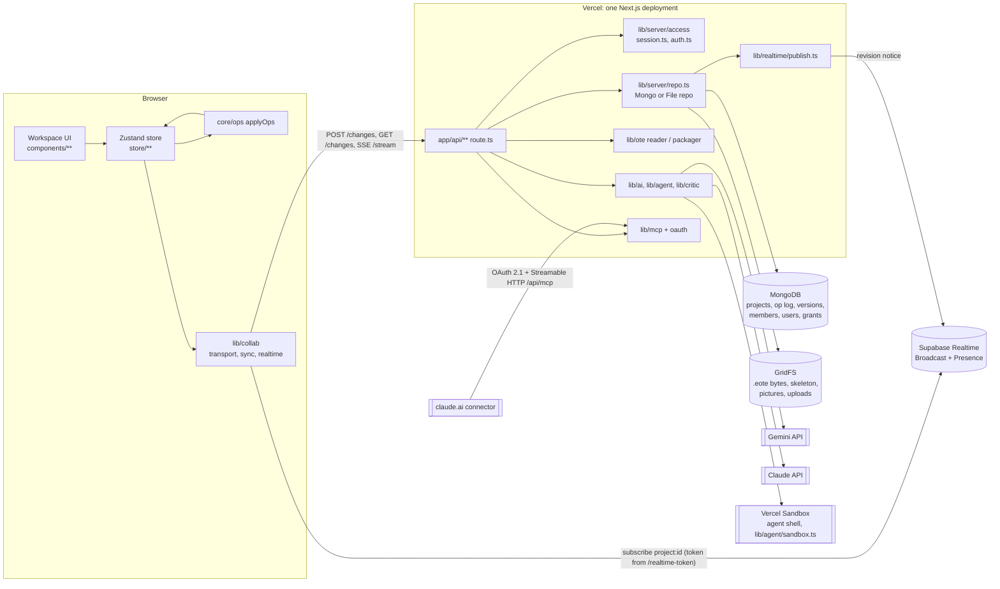

- **MongoDB** holds everything except bytes. Without `MONGODB_URI`, `repo()` falls back to `FileRepo` in `web/.data` (`lib/server/repo.ts:364-367`). On Vercel it refuses to fall back (`:366`).
- **GridFS** holds the binaries, through `Storage.bytes` (`lib/server/storage.ts`).
- **Supabase** is used for Realtime only: Broadcast for revision notices, and Presence. The browser gets a 15-minute token minted by `/api/projects/[id]/realtime-token` (`lib/realtime/token.ts`). Without Supabase, the browser uses SSE from `/api/projects/[id]/stream`.
- **Vercel Sandbox** runs the agent's shell commands (`lib/agent/sandbox.ts`). The agent's other tools work on an in-memory workspace of the project's files.
- **Gemini / Claude**: `AI_PROVIDER` picks the provider (`lib/ai/provider.ts`). Locally and on production today it is Gemini: flash-lite for chat, flash for the agent (`lib/agent/run.ts:92`).

## 3. The paths, one by one

Each subsection below was written by the stream that read those files, and was checked by the orchestrator.

| Path | Section |
|---|---|
| `.eote` / `.co` in, the screen model, ops, saving, `.eote` out | 3.1 |
| Sign-in, sessions, authorisation, live sync (server side) | 3.2 |
| Chat, generate, the agent, MCP and OAuth | 3.3 |
| Client store, start pane, history, export screens | 3.4 |
| The canvas: screen model to canvas to ops | 3.5 |
| The server renderer and the generator's look | 3.6 |


### 3.1 Format, model, ops, saving (S1)

##### .eote in: import to the store

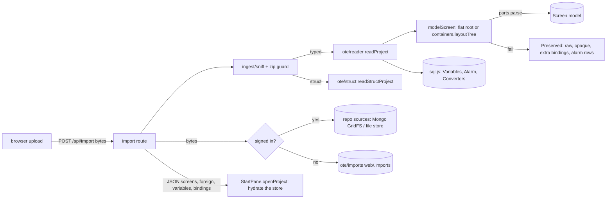

##### Ops: the only write path

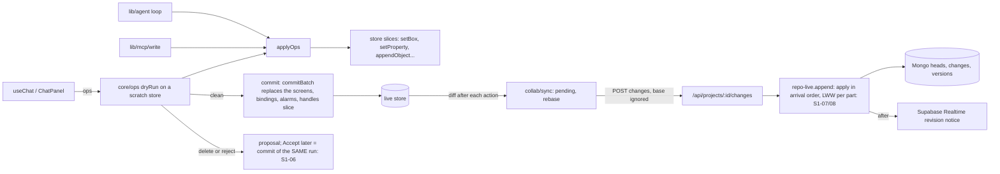

##### .eote out: saving

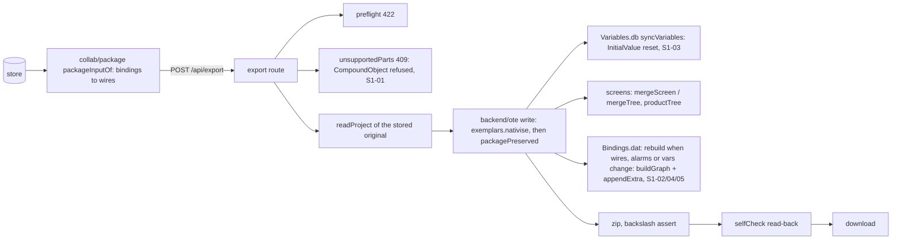

Where the platforms sit:

- **Mongo and GridFS:** source bytes and snapshots (repo). The audit never
  touched them (`MONGODB_URI=` empty).
- **Supabase Realtime:** revision notices only, after `append`.
- **Vercel Sandbox:** the agent's shell, not on these paths.
- **Gemini and Claude:** produce ops upstream of core/ops and never write files.

### 3.2 Identity, authorisation, live sync (S2)

##### B1. Identity and sessions

`currentUser()` (lib/server/session.ts:28-33) is the only identity source for routes:
- no `AUTH_SECRET` and not on Vercel: everyone is `{ id: "local" }` (laptop mode);
- no `AUTH_SECRET` on Vercel: nobody (null);
- `AUTH_SECRET` set: Auth.js JWT cookie (`authjs.session-token`, HttpOnly, SameSite=Lax, Secure on https) decoded by `auth()`.

Accounts live in the repository's `users` table (bcrypt hash, `emailKey` unique index in Mongo, storage.ts:199).
Sign-in is Auth.js Credentials (auth.ts:19-24) calling `verifyPassword` (credentials.ts:109-128). There is no
Auth.js adapter and no session table: a session is only the signed JWT.

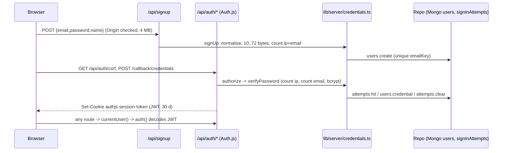

##### B2. Authorisation

`requireAccess` (access.ts:55-60): 401 no user, 404 no project, 403 no permission. `requireReader` (access.ts:67-77):
404 first, then share-cookie viewer access for a signed-out browser. Role matrix access.ts:14-19. A share
link is a 32-byte token; only its SHA-256 is stored (shares.ts:23-30). Signed-in visitors join as members
(repo-collab.ts:155-171); signed-out visitors get viewer-only read through the `hmi_share` cookie
(shares.ts:115-124). Sources (opened files) are authorised by owner or by a readable project referencing them
(access.ts:80-108); anonymous imports are 24 h capabilities keyed by random UUID (lib/ote/imports.ts).

##### B3. Live sync (server side)

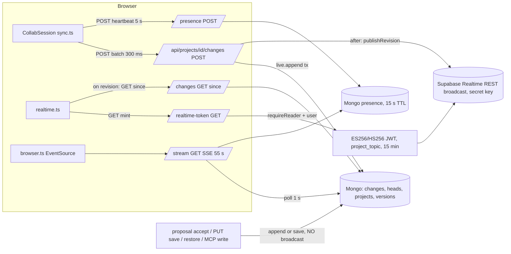

The policy file supabase/migrations/20261030170741_realtime_policies.sql lets an `authenticated` token SELECT
and INSERT on `realtime.messages` only where `realtime.topic() = auth.jwt()->>'project_topic'`. Presence is not
on the channel; it is the heartbeat route. Proposals and agent steps exist only on the SSE stream
(stream/route.ts:28, proposals.ts:161-189); the Realtime transport subscribes to `revision` only
(realtime.ts:246).

---

### 3.3 Chat, generate, agent, MCP and OAuth (S3)

**MCP connector.** One stateless route. A server is built for each request, so nothing is kept between calls. Every tool reaches a project through `openProject`, which calls `access.ts`. Writes go through `core/ops` `dryRunOnSnapshot`. The result then goes either to the proposal queue or to the change log (`live.append`), the same log the browser uses. `generate` runs in `after()` and records its progress in a job row in Mongo.

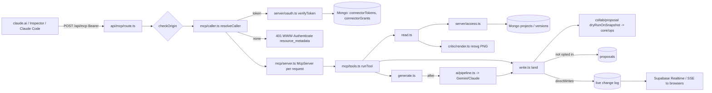

**OAuth.** We are both the authorization server and the resource server. Everything lives under /api/oauth/* and /oauth/authorize. Rows are stored as SHA-256 hashes in Mongo, or in web/.data on a laptop.

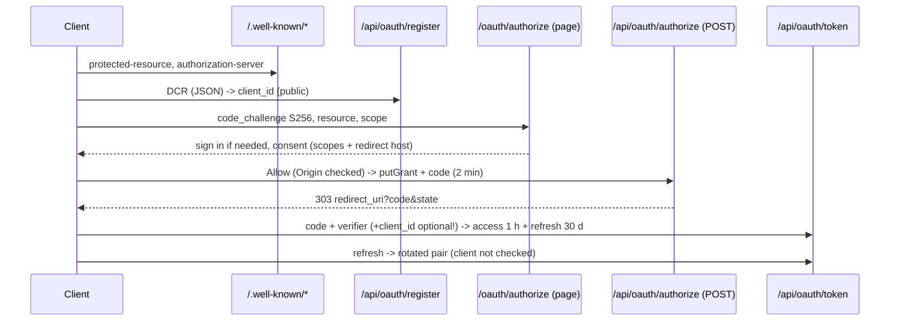

**Agent (Agent tab).** /api/agent opens the source file into an in-memory `Workspace`. `run.ts` loops the model over `tools.ts` for at most 40 steps. It talks to Gemini through `@google/genai` or to Claude through the Anthropic SDK. The tools are:
- QuickJS `run_script`, which runs in-process;
- `shell`, which runs in a Vercel Sandbox microVM (`@vercel/sandbox`, only when OIDC is available);
- `view_screen`, which renders with resvg.

When the run changed something, the result is stored as a new source: `repo.sources` (GridFS/Mongo or the file store) for a signed-in user, `putImport` otherwise.

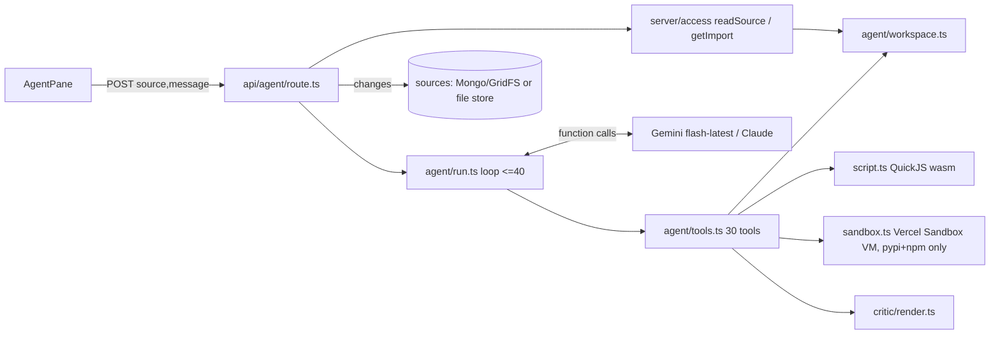

**Chat (Chat tab).** The browser builds a digest of the project, which carries handles and regions but no coordinates. /api/chat makes one model call with a JSON schema, or with Claude, up to 4 lookup rounds then one structured call. It returns a `Turn`. The browser then dry-runs the ops in `core/ops`, makes one repair call if any op was rejected, and either commits or proposes. Geometry is computed by `core/ops` + `lib/ote/tidy.ts`/`store/edits.ts`, never by the model.

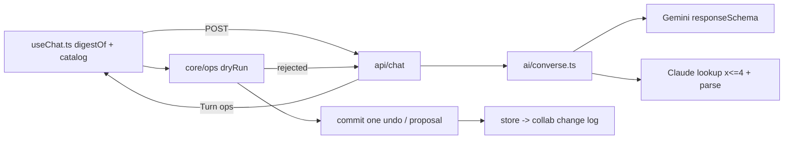

**Prompt injection.**
- MCP fences every customer string inside `<project-data>` and tells the model that project text is data (mcp/server.ts:38-43, data.ts). tests/mcp.test.ts covers this.
- The **agent has no fence and no such line in its prompt** (agent/run.ts:54-72). Tag comments and object text go into tool results as they are (tools.ts:441, 397).
- The agent also has write tools and, where a sandbox exists, a shell whose network allow-list includes two package registries that accept uploads (sandbox.ts:40). Whether a project's text can steer the agent into publishing it was **not tested**: there is no OIDC token here and no sandbox. It is listed as an open risk, not as a bug.
- Chat ops are typed and checked against the schema. Deletes always go to a proposal (ai/review.ts:37-40), so an injected "delete everything" needs a human to accept it.

**Cost and timeouts.**
- Agent: at most 40 steps (run.ts:94) and 120 s per model call (run.ts:77). Gemini waits up to 65 s, 3 times per step (run.ts:233-247). The route allows 300 s (agent/route.ts:28). There is no per-user limit.
- Chat: one call, plus up to 4 lookups on Claude, plus one repair. The route allows 120 s. No limit.
- MCP `generate`: per-user and per-project counters (generate.ts:399-400). It is the only model path with a limit.
- `/api/critique`, `/api/generate`, `/api/regenerate`: no limit and no sign-in (S3-04).

### 3.4 Client store and screens (S4)

**Entry points.**
- `/` (landing, server component). StartButtons and Routes call useNewProject: createProject in localStorage, reset, then router.push.
- `/project/[id]`: Workspace runs useProjectHydration and useCollab, decides the start pane, and renders WorkspaceShell (ChatPanel, CanvasPane, Inspector).
- Other `/project/[id]/*` pages: PageShell, which hydrates through the same hook.
- `/s/[token]`: SharedProjectView, which never writes local storage.
- `/account/connections` and `/oauth/authorize`.

**Load.**
1. useProjectHydration calls loadCloudProject. That reads `/api/me`. If signed in with cloud on, it GETs `/api/projects/<id>`, sets the role in useAccess, and caches the snapshot to localStorage.
2. If there is no cloud copy, it falls back to the localStorage `hmi-copilot:project:<id>`, then to a blank screen.
3. It then probes `/api/panel`. When the skeleton's Target.dat is known, an untouched blank project is re-cut to that panel.

**Save.**
- The autosave subscribes to the whole store, debounced 600 ms. It runs saveProject (localStorage) and touchProject (the index).
- scheduleCloud runs 1.5 s later: POST `/api/projects` the first time, then PUT `/api/projects/<id>` with the revision. A 409 sets a conflict, shown as "Changed elsewhere" with Reload or Keep yours.
- In a live session (owner, editor), setLiveProject turns the whole-snapshot save off. Edits go as diffs through CollabSession: POST `/changes`.
- The server broadcasts a revision hint on Supabase Realtime (token from `/realtime-token`). Peers GET `/changes?since=`.
- Without Supabase, or for an anonymous viewer, the session uses SSE `/stream`.
- Presence is a POST `/presence` heartbeat every 5 s (measured).

**Chat and generation.**
- useChat POSTs `/api/chat` with a digest and a catalog. Gemini or Claude runs server-side.
- Edit ops are dry-run on a scratch store (core/ops), then committed as one undo step or kept as a pending proposal.
- Builds go to useGeneration: SSE `/api/generate`, events applied one by one.
- In any server project, sharedTurn routes edits to POST `/proposals` and builds to POST `/agent` (a server job). The result is a server proposal, delivered by a stream event or a reload.

**Export.**
- useExport, for a local project: POST `/api/export` with packageInputOf(store). For a live project: `{projectId, rev}`, and the server packages its own snapshot.
- Then `/api/export/report`, then the zip and README built in the browser (jszip).

**Where the services sit.**
- Mongo or file store, and GridFS: behind every `/api/projects*`, `/api/import` and `/api/export` call.
- Supabase: only the realtime token and the channel, from lib/collab/realtime.ts.
- Gemini/Claude: behind `/api/chat`, `/api/brief/draft`, `/api/generate`, `/api/projects/<id>/agent`, `/api/critique` and `/api/agent`.
- Vercel Sandbox: behind `/api/agent` (S3/S5).

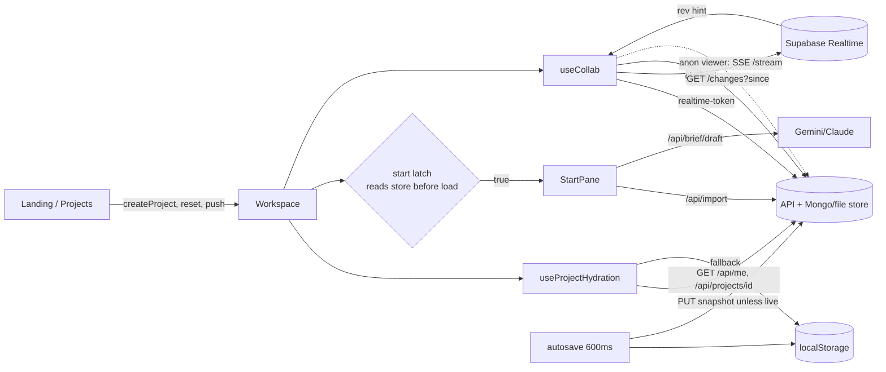

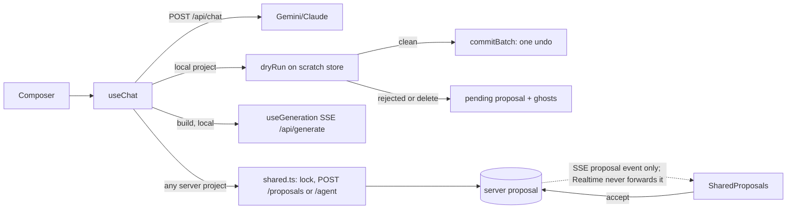

### 3.5 Canvas (S5)

- **Read.** `readProject` (lib/ote/reader.ts) parses each Screen.dat.
  - A flat ViewBox/Canvas root is modelled part by part.
  - A container root (Grid etc.) goes through `layoutTree` (lib/ote/containers.ts). It is flattened to absolute
    leaves under a synthetic Canvas root. The original tree plus `laid` stay in `preserved.screens[id].tree`.
  - CO instances are modelled as `CompoundObject` parts with a `Look` (co-look.ts).
  - Unmodelled leaves go to `foreign`.
- **Store.** The store (zustand, src/store) holds `screens[].Children[0].Children` as the flat edit model, plus
  objectMeta (lock, hide, groupId), composites, bindings, handles.
- **Canvas.** CanvasPane chooses ScreenBoard or a single ScreenRenderer. Each renders PartNode per part, and
  ForeignLayer for carried objects. Pointer to screen units goes via the SVG's bounding rect.
- **Edits.**
  - Every gesture calls a store action (nudge, setBox, align, spread, restack, setProperty, appendObject).
  - Chat, MCP and the agent's chat ops go through `core/ops/apply.ts` `applyOps`, then the same store actions.
  - Proposals: `dryRun` on a copy, then `previewOf`, then ghosts in ScreenRenderer.
- **Write.** The packager writes flat screens back with opaque parts at their index. Container screens go
  through `mergeTree` back into the original tree.
- **Server render.** StaticScreen, via lib/critic/render.ts, serves `render_screen` (MCP), `view_screen`
  (agent) and the critic.
- **Where external services sit.**
  - None of these files touch Mongo, GridFS or Vercel Sandbox directly.
  - Supabase Realtime/SSE reach the canvas only as `presence` and through the store's collab change log.
  - Gemini/Claude reach it only as ops.
  - Pictures come from GridFS through `/api/picture/<sha>` (DrawEnv.pictureUrl).
  - Regenerate calls `/api/regenerate`. Import screens calls `/api/import/screens`.

```mermaid
flowchart LR
  F[.eote / .co] --> R[readProject<br/>lib/ote/reader.ts]
  R -->|flat root| M[Screen model<br/>Children[0].Children]
  R -->|Grid/Stack/Group root| L[layoutTree<br/>containers.ts]
  L -->|absolute leaves| M
  L -->|tree kept| P[(preserved.tree)]
  R -->|CO instance + Look| M
  R -->|unmodelled| FO[foreign]
  M --> S[(zustand store<br/>+ objectMeta, composites, bindings)]
  S --> CP[CanvasPane]
  CP --> SB[ScreenBoard] --> SR[ScreenRenderer]
  CP --> SR
  SR --> PN[PartNode / LookNode / ContentDisplay]
  FO --> FL[ForeignLayer]
  SR -->|drag, resize, draw| A[store actions<br/>nudge setBox align spread restack]
  TB[CanvasToolbar / keys / menu / Inspector / Layers] --> A
  CH[chat / MCP apply_ops / agent ops] --> O[core/ops applyOps<br/>dryRun -> ghosts]
  O --> A
  A --> S
  S --> PK[packager]
  P --> MT[mergeTree] --> PK
  PK --> OUT[.eote out]
  S --> ST[StaticScreen] --> RS[critic/render.ts<br/>render_screen, view_screen]
```

## 4. Where the docs and the code disagree

Each row was found by the stream named in its section. A doc line and a code line are cited for each.

### Found by S1

| Doc says | Code does |
|---|---|
| CO_FORMAT.md:137-142 "The instance is a part ... selected, moved, aligned, resized, copied and deleted" (an exportable edit implied) | The export route refuses any project holding one: backend/types.ts:165-178 with PART_TYPES (schema.ts:910-938). S1-01. |
| PLAN_PROJECT_NATIVE.md §3 Phase 1 and Phase 4 "the fidelity check stays at zero", "from more than 7,500 lost fields to 0" | fidelity.ts:78-92 compares screen objects only. Bindings.dat rewrites (S1-02), InitialValue resets (S1-03) and dangling rows (S1-04) are outside what it counts. |
| schema.ts:817-821 "a screen rooted in [Grid] is carried through unmodelled" | reader.ts:202 + 239-288 model Grid roots through containers.ts |
| backend/ote.ts:18-22 "Composites are ours, not the file's, until .co compound objects land" | CO instances are parts since 2026-10-30 (schema.ts:512-519) |
| collab/proposal.ts:6 "the same applier the chat uses in the browser (lib/ai/applier.ts)" | It imports core/ops (proposal.ts:14). lib/ai/applier.ts is dead (graph.json). |
| packager.ts:13-15 "only Variables.db, Alarm.db and the screens are written" | Also Bindings.dat, Converters.db, Resources, Project.dat and Contents\Hierarchy.dat (packager.ts:575-623) |
| reader.ts:4-8 "nothing read is ever lost ... comes back byte-identical" | True of an untouched write. After a binding rebuild it is false (S1-02/04/05), and after a tag edit (S1-03). |
| repo-live.ts:12-16 documents last-writer-wins per part | Consistent with the code. The Change type carries `base` (collab/types.ts:97-98), which no server code reads. |
| IMPORT_FIDELITY and the brief: "panels throw errors when read" | No throw reproduced on 15 files; see the MasterScreen and HardwareConfiguration findings |

### Found by S2

| Doc says | Code does |
|---|---|
| PLAN_FULL_ARCHITECTURE.md:8 "today the app signs in only through GitHub and Google ... providers() enables sign-in only when AUTH_GITHUB_\* or AUTH_GOOGLE_\*" | Credentials only, switched by AUTH_SECRET (session.ts:18-20, auth.ts:19). Stale. |
| PLAN_FULL_ARCHITECTURE.md:47 Realtime carries "who is in a project" (Broadcast and Presence); :159 "Supabase Realtime Broadcast per project ... and Presence" | Presence deliberately stays on the heartbeat route (realtime.ts:127-140, REALTIME_SETUP.md:151-157). Plan is stale. |
| REALTIME_SETUP.md:145-146 "`insert` is sending one" (a client needs to broadcast) | No browser code sends on the channel (grep `channel.send` in src: 0 hits); the server publishes with the secret key, which bypasses RLS. The INSERT policy grants viewers a write they never need (S2-11). |
| REALTIME_SETUP.md:119-121, PLAN §6 phase 2 "two browsers see each other's revisions within a second" | True only for edits through POST /changes. Accepted proposals, PUT saves, restores and MCP writes are not announced (S2-04). |
| REALTIME_SETUP.md:39-42 "a share-link visitor with no identity gets a 401 from the mint route" | True (realtime-token/route.ts:29), but a signed-in non-member holding a viewer cookie does get a token (requireReader honours the cookie). Consistent with read access; undocumented. |
| shares/[shareId]/route.ts:1 "Revoking a link stops it working at once" | The link stops; every account that already joined through it stays a member with the link's role (repo-collab.ts:148-154 only sets revokedAt). |
| tags/parse/route.ts:17-18 "limit is 16 MB"; vijeo/migrate:32 and import/screens via readBody: 100 MB | Vercel's function body limit is 4.5 MB; these routes are posted whole (useTagImport.ts:239, StartPane.tsx:224, ImportScreensDialog.tsx:43), so on production the stated limits are unreachable (S2-13). lib/client/upload.ts:1-5 shows the authors know the 4.5 MB ceiling. |
| lib/server/snapshot.ts:9 / lib/client/snapshot.ts:216: snapshots up to 64 MB | Versions and heads are single Mongo documents (storage.ts:185, repo.ts:194-196, repo-live.ts:139-140): BSON max 16 MiB (S2-12). lib/ote/imports.ts:103 already refuses >15 MB for the same reason. |
| credentials.ts:13-15 "sign-in ... cannot be used to ask who is registered here" | True for sign-in; sign-up answers 409 `unavailable` for a taken address (repo.ts:83), live-checked locally. Documented in the same comment, so not a mismatch, but it is an enumeration oracle rate-limited to 10 per address / 50 per IP per 15 min. |
| rate-limit.ts:74-76 "a forged value divides an attacker's own allowance rather than anyone else's" | A forged X-Forwarded-For gives the attacker a fresh 50-attempt IP bucket per value wherever the host does not overwrite it (S2-14). |
| graph.json marks src/lib/realtime/check.ts dead | Imported by web/scripts/realtime-check.mts and tests/realtime-fixes.test.ts. |

---

### Found by S3

| Doc | Code | Mismatch |
|---|---|---|
| docs/AGENT_WORKSPACE.md:42 "Core files (...) cannot be deleted" | web/src/lib/agent/tools.ts:275-280, script.ts:241 | A folder, `""`, or `run_script` deletes them (S3-02) |
| docs/AGENT_WORKSPACE.md:19 (sandbox) "The network reaches only pypi and npm, so nothing can be sent elsewhere" | sandbox.ts:40 allow-list | Both registries accept uploads, so "nothing can be sent" overstates it. Not tested (no sandbox here). |
| docs/CONNECTOR_SPEC_NOTES.md:27-28 quotes Claude: "Claude follows the 2025-03-26, 2025-06-18, and 2025-11-25 authorization specifications" | https://claude.com/docs/connectors/building/authentication (read 2026-11-04) | The current page no longer has that sentence; it links 2025-11-25 only |
| docs/CONNECTOR_SPEC_NOTES.md:83-86 "DCR is simpler ... so DCR it is" | MCP 2026-07-28 client-registration | DCR is now **deprecated**, CIMD is SHOULD, and Claude prefers CIMD for directory traffic |
| oauth.ts:89 consent label for `mcp:write`: "Propose changes ..., which an editor still has to accept" | mcp/write.ts:198-251 | On a project with direct writes, `apply_ops` lands with no editor |
| docs/RESEARCH_CLAUDE_AI_INTEGRATION.md:86 "Rate limits and cost ... Put a per-user and per-project limit on it" | api/chat, api/agent, api/critique, api/generate | Only MCP `generate` has a limit (S3-04) |
| docs/LLD.md:325-326 "No open-ended agent loop ... the number of model calls is at most three" | converse.ts MAX_LOOKUPS=4 (lookup) + 1 parse + repair; agent/run.ts 40 steps | The Claude chat path makes up to 6 calls, and the agent is the open loop the LLD ruled out |
| docs/AUDIT_2026-10.md §6 "a seven-tool LLM registry" | web/src/lib/ai/tools.ts TOOLS | 9 tools now (project_style, target_capabilities added) |
| docs/AGENT_WORKSPACE.md:66 default Gemini agent model `gemini-flash-latest` ("flash-lite is the one that stays available") | run.ts:92 | Matches. Measured: flash-latest answered 503 on both runs here (F2), so the default is the unavailable one |

### Found by S4

| Doc says | Code does | Where |
|---|---|---|
| README "869 tests"; landing "699 tests" | 1446 passing (baseline) | README.md Status; src/app/page.tsx:204 |
| DEMO.md beat 1 "Click **Open the workspace**"; beat 2 "Nav rail → **Tags** → *Use the sample plant export*" | No such button; the landing says "Start a project". The samples are buttons on the start pane and the Tags page | docs/DEMO.md table; StartButtons.tsx |
| DEMO.md "Open a second tab on `/project/demo`"; "Reload `/project/demo`" | The demo id was removed; /project/demo is an empty new project | StartButtons.tsx:629-631 comment; useProjectHydration.ts:19-23 |
| DEMO.md "`/api/generate` is still the stub ... labels itself local pipeline" | Generate is live; the fallback runs only on a network failure, and only over the demo tags | useGeneration.ts:178-237, mockPipeline.ts:98-115 |
| DEMO.md beat 12 "Nav rail → Export → **Generate files**" | Matches | |
| LLD §1.3 "useChat.ts:94 sends the last 12 messages as {role,text}" | Now 24 messages, with turn records (F4 landed) | useChat.ts:36, 259-266 |
| HistoryScreen "Versions live in this session" | Versions persist in localStorage with the project | useProjectHydration.ts:262; HistoryScreen.tsx:401 |
| SettingsScreen "The project lives in this browser tab. Nothing is uploaded" | localStorage, /api/import, knowledge scan, and the server for signed-in users | SettingsScreen.tsx:112-114; persist.ts:198-208 |
| SettingsScreen header "Only settings that do something are offered" | "Correct tag names on import" is read by nothing | StandardsScreen.tsx:180-183 |
| ProjectsScreen "localStorage cards ... can be explicitly uploaded after sign-in" | Any project opened while signed in auto-uploads via scheduleCloud (pmw1spa4v was on the server without Upload) | persist.ts:198-229; flow 2 step 6 |
| useComments "a later phase replaces the interval with the project's change stream" | Still a 10 s poll (measured) | useComments.ts:189-192 |
| SharedProjectView "Live: the visitor sees edits as they land" | True via SSE (measured) | SharedProjectView.tsx:85 |
| PLAN_FULL_ARCHITECTURE §2.3 "Broadcast carries a small notification" | True for client changes; accepting a proposal sends none, so the accepting tab is not updated (measured) | flow 2 step 9 |
| useCollab / shared.ts "In a shared project the turn takes its screen" | Applies to every server project, including a private one with a single owner | shared.ts:280-285 |
| CommandPalette "Opens on Ctrl/Cmd+K anywhere that is not a text field" | No text-field check | CommandPalette.tsx:230-242 |
| requirements.ts "Change it in Project settings" | The panel is set only in the palette or the top-bar chip | requirements.ts:379 |
| TemplatesScreen "a second pump block is PUMP 2" | Always PUMP 1 | TemplatesScreen.tsx:113-117 (test) |
| PlantScreen "Rebuild ... keeping your answers and your ranges" | Keeps the answers only | PlantScreen.tsx:305-306 (test) |
| useExport README "Variables.csv ... a copy of what is already inside the .eote" | Not for a screens-first project | useExport.ts:85-87 (test) |
| HANDOFF_SCREENS_FIRST step 3 "pending names out of Variables.db until bound" | Done for the .eote (package.ts:19), not for the CSV | |

### Found by S5

| Doc says | Code does |
|---|---|
| ScreenRenderer.tsx:110 "Screen units per CSS pixel" | CanvasPane.tsx:512 `scale = zoom/100` is CSS px per screen unit; px() at ScreenRenderer.tsx:295 divides by it |
| LibraryScreen.tsx:13-18 "Placing one is deliberately unavailable ... the index stores only the SVG d" | 474 of 474 index entries carry Commands and Points; LibraryScreen.tsx:208-216 shows Place |
| LayersPanel.tsx:6-9 "dragging a row ... changes the file" | not for container-rooted screens: containers.ts:363-381 keeps the original order (S5-01) |
| docs/LLD.md:429-431 "Only the active screen renders live; the board shows thumbnails ... cached by screen hash" | ScreenBoard.tsx:352-387 mounts a full live ScreenRenderer per frame; no thumbnail or cache |
| docs/PLAN_FULL_ARCHITECTURE.md:22 the knowledge base "stores them in Mongo, or in .knowledge/"; ".knowledge/ does not exist" | store.ts:27-32: with MONGODB_URI set the store is "off" unless KNOWLEDGE_STORE=mongo; production GET /api/knowledge answers store "off" (2026-11-04); web/.knowledge now exists and is empty |
| knowledge/scan.ts:22-25 records "structure and names, never the file" | it also keeps on-screen text up to 80 chars and alarm messages verbatim (scan.ts:61,97,389,402) |
| lib/ai/tools.ts:266 "a part type that is not Rectangle, TextBox, Lamp or NumericDisplay" | schema.ts:910 PART_TYPES has 27 types the packager emits |
| tidy.ts header (implied by `tidyLayout` naming in converse.ts:438-444, "tidy this screen") | planTidy optimises overlap only; it does not keep alignment (measured, design A §1.4) |

### Found by S6

| # | Doc says | Code does | Evidence |
|---|---|---|---|
| C1 | `web/src/lib/critic/render.ts:6-8`: "Same component, same pixels as the browser - the one difference is the font" | resvg ignores `vector-effect="non-scaling-stroke"` (`Shapes.tsx:59`, `GraphicObject.tsx:79`) and paints no CSS background (`StaticScreen.tsx:107`). So stretched strokes are hairlines and the paper is transparent in the PNG | `web/scripts/audit/s6-server-render-strokes.test.ts` (2 failing) |
| C2 | `web/src/components/canvas/parts/GraphicObject.tsx:73-78`: non-scaling keeps the outline at its Thickness, "what makes a grey symbol read on a grey ground" | True in a browser only. In the server PNG the outline is 2 x w/3072 px | same test, S6-01 |
| C3 | `web/src/components/canvas/parts/BasicParts.tsx:14`: "Half full, when nothing is driving it. A bar drawn empty reads as broken" | Every generated bar is written with `VerticalFill: 0` / `HorizontalFill: 0` (`web/src/lib/ote/parts.ts:89,116`), so the fallback never applies and every bar draws empty | measured: 82 bars on 36 screens (s6-render.mts) |
| C4 | `docs/ARCHITECTURE_SCREEN_QUALITY.md:51`: under "What we have today", "8-pixel grid" | Zones are off the 8 grid: `layout.ts:109-118` (HEADER 44, FOOTER 28, MARGIN 12, CARD height 162, TILE 238x100) | measured: mean 48 % of box edges on the 8 px grid (range 29-75 %), 36 pipeline screens |
| C5 | `docs/ARCHITECTURE_SCREEN_QUALITY.md:174-177`: pack rules `colour.noFillForNormal`, `indicator.analogueFirst`, `alarm.priorityShape`, `frame.master` | `web/src/lib/standard/lint.ts:100-154` implements only `colour.abnormalOnly`, `text.fontFloor`, `layout.offGrid` and `density.max` | grep of `rule: "` in lint.ts |
| C6 | `web/src/components/standards/StandardsScreen.tsx:113`: "Every generated screen is built from these tokens" | Trend channels use GREEN, AMBER, BLUE, RED, TEAL, DARK_GREY (`parts.ts:421`); indices 3, 4, 6, 5 and 7 are in neither `neutralSet` nor `signalSet` (`pack.ts`). `applyPack` leaves them on purpose (`standard/apply.ts` header) | code read |
| C7 | `web/src/lib/critic/geometry.ts:207-231` (`geom.symbolInvisible`) says it catches "the symbols are nearly invisible" | It passes any Path with a 2 px #515151 border, which the PNG does not draw (C2). It fired 0 times on 36 screens, where every symbol fill is 1.25:1 against what is behind it | s6-render.mts metrics.json |
| C8 | docs/PROMPT_FOR_PRANAV.md Part 6B: "the installed and downloaded Pro-face COs" | No OTE editor is installed on this machine. The only library file is `C:\ProgramData\Schneider Electric\EcoStruxure Operator Terminal Expert\4.4.20.0\CompoundObjects\COs.pkg`: 14 Schneider COs (Gauge, BarGraph), matching `docs/CO_FORMAT.md:11`. The 21 downloaded Pro-face COs (`CO_FORMAT.md:12`) are not on this machine | scratch copkg.py over COs.pkg |
| C9 | `web/src/lib/standard/pack.ts:39`: "Running or open is an outline change, never a fill" (the pack's own design rule) | Measured: the On and Off lamp faces differ by 1.13:1 in fill and a 1 px border step. Design B proposes reversing the rule. This is a design disagreement, not a code bug | contrast computed |

#### E. Bugs

##### S6-01 Server rasteriser draws Line, PolyLine, Polygon, Bezier and Path strokes as hairlines
- Severity: P2 wrong output
- Where: web/src/components/canvas/parts/Shapes.tsx:59, web/src/components/canvas/parts/GraphicObject.tsx:79 (rasterised by web/src/lib/critic/render.ts:72-85)
- Repro: render a screen with a Line part (Thickness 2, black, 100x40 box) through `screenToSvg`, then resvg.
- Expected: a 2 px dark line, as the editor draws it.
- Actual: the darkest pixel is 246/255. resvg ignores `vector-effect="non-scaling-stroke"` and scales the stroke by box/3072. Library symbols lose their outline the same way.
- Proof: web/scripts/audit/s6-server-render-strokes.test.ts (fails with "darkest pixel on a 2 px black line is 246/255: resvg ignored vector-effect="non-scaling-stroke" and drew a hairline")
- Users hit: every PNG the app makes:
  - the agent's `view_screen` (`lib/agent/tools.ts:615`);
  - the MCP screen render for claude.ai (`lib/mcp/read.ts:183`);
  - the vision critic (`lib/critic/critic.ts:220`, `app/api/critique/route.ts:41`).
  - Worst on imported engineer screens, which use Line, Polygon and Path.
- Fix: map the 3072-unit points into the part's box in code, and draw a plain path with no nested viewBox
  stretch. The stroke is then right in browser and resvg alike. Renderer only, no writer change.
- Last audit: new

##### S6-02 Server PNG has a transparent background where no part covers the screen
- Severity: P3 cosmetic
- Where: web/src/components/canvas/StaticScreen.tsx:107 (`style={{ background: PAPER }}`)
- Repro: `screenToSvg` of an empty screen, rendered by resvg; read the alpha of the centre pixel.
- Expected: alpha 255, paper #f1f1f1.
- Actual: alpha 0. 17 % of the pump-station fixture's PNG is transparent black. A vision model may see it as
  black or as white.
- Proof: web/scripts/audit/s6-server-render-strokes.test.ts (fails with "the centre of an empty screen has alpha 0: the paper is a CSS background resvg does not paint")
- Users hit: screens with no full-screen ground Rectangle: imported screens and the fixture. Generated screens
  draw a Ground rectangle.
- Fix: draw `<rect width height fill={PAPER}/>` as the first child instead of the CSS background.
- Last audit: new

##### S6-03 Every generated bar is drawn empty on the canvas and in the PNG
- Severity: P3 cosmetic
- Where: web/src/lib/ote/parts.ts:89,116 (writes 0), web/src/components/canvas/parts/BasicParts.tsx:45 (draws the 0)
- Repro: generate any sample (`buildFromTags`) and render it.
- Expected: a design-time bar the renderer's own rule calls readable (half full, `BasicParts.tsx:14-15`).
- Actual: an empty white trough with a black band frame on it.
- Proof: measured: 82 bars with fill 0 on 36 pipeline screens (web/scripts/audit/s6-render.mts, metrics.json `emptyBars`).
- Users hit: all users who generate screens (every AnalogIndicator).
- Fix: write the band's middle (or 50) as the design value in `fillBar` and `rectangle({ fillLevel })`. The
  binding replaces it at runtime. This changes a value the `.eote` writer emits, not its format: confirm with
  Shaurya.
- Last audit: new

##### S6-04 A level 2 card's equipment symbol overlaps its first analogue indicator
- Severity: P2 wrong output
- Where: web/src/lib/ote/layout.ts:454 (symbol at y+8, 52 px tall) vs web/src/lib/ote/layout.ts:511 (first indicator row at y+40 when the unit has no run or fault lamp)
- Repro: `buildFromTags` on samples/tank-farm/tags.csv ("tank farm overview"), then `critiqueGeometry` on each screen. Needs the gitignored graphics index, so that units carry a symbol.
- Expected: no overlap.
- Actual: the symbol overlaps the indicator frame by 52x16 px, and the value box and unit by 4x12 and 36x10 px.
  This happens on 9 of 36 sample screens; those screens score 1.0-1.8 of 5 on the geometric critic.
- Proof: web/scripts/audit/s6-card-symbol-overlap.test.ts (fails with "18 symbol/indicator overlaps, e.g. "Sym_X overlaps Ind_XX by 52x16px; one of them is unreadable."")
- Users hit: generators whose units have readings but no run or fault BOOL (tanks, valves, instruments), on
  machines with the symbol library indexed.
- Fix: start the readings below the symbol: `rowTop = y + max(run || fault ? 86 : 40, 8 + symbolSize + 4)`, or
  narrow the first row by the symbol's width. Full fix: design B's components own their boxes.
- Last audit: new

##### S6-05 Rectangle CornerRadius is carried but never drawn
- Severity: P3 cosmetic
- Where: web/src/components/canvas/parts/BasicParts.tsx:31-38 (plain `<rect>`, no rx/ry)
- Repro: open any engineer project with a rounded rectangle, e.g. `HMICopilot_Panel1.eote`, which has 1 `CornerRadius`. Shipped sample: `reference/part_examples.json` Rectangle corpus, `CornerRadius {Style: 2, TopLeft..BottomRight: 5}`.
- Expected: rounded corners as OTE draws them.
- Actual: square corners.
- Proof: measured: 1 `CornerRadius` in each of `HMICopilot_Panel1.eote`, `Motor_Drive_Control_4.1.eote`, `HMICopilot_Drive_4.1.eote`, `auto&manua.eote` and `auto-manual.eote`; 0 rx in 1,791 `<rect>` drawn by the renderer over 38 screens.
- Users hit: importers, rarely (one per engineer project).
- Fix: read `CornerRadius` (pass-through today) and set `rx`/`ry`, which is per corner when the four differ (draw a path).
- Last audit: new

#### F. Other output
- docs/audit/DESIGN_SCREEN_VISUALS.md (design B), sections 1-8.
- web/scripts/audit/s6-render.mts: renders and measures the generated set, or any .eote given as arguments.
- web/scripts/audit/s6-server-render-strokes.test.ts (S6-01, S6-02) and s6-card-symbol-overlap.test.ts (S6-04): 3 failing tests.
- Scratch only (never commit): renders/, eng-renders/ (engineer screens), hmi-photos/ (converted photos),
  heic2png.py, copkg.py, count.py, vef*.mjs.
- Flag for the orchestrator: design C's component id example `comp:pump.faceplate.l2` vs design B's
  `comp:<kind>.<variant>` (design B §8).

### Found by the orchestrator

| Doc | Says | Code |
|---|---|---|
| docs/LLD.md:459 | `lib/ai/applier.ts` is the pure applier, "from `components/chat/applyOps.ts`" | Neither is imported by the app: `graph.mts` lists both with no importer. The applier is `core/ops/apply.ts`. `components/chat/applyOps.ts` is reachable from nothing at all. |
| docs/PLAN_FULL_ARCHITECTURE.md:18 | "Suite: 1184 passing, 17 skipped" | 1446 passed, 24 skipped, 110 files (this audit's baseline) |
| docs/PLAN_FULL_ARCHITECTURE.md:8 | sign-in is GitHub and Google only | Credentials only (`src/auth.ts`, `lib/server/credentials.ts`); GitHub and Google are gone |
| docs/PLAN_FULL_ARCHITECTURE.md:19 | a filesystem fallback in `.imports/` | the repository's fallback is `FileRepo` in `web/.data` (`lib/server/repo.ts:358`) |
| codebase map given to the audit | `web/src/app/api/tags/draft/` | the route no longer exists; only `tags/match` and `tags/parse` |

## 5. Import graph facts

- **Two cycles** in static value imports: `components/canvas/parts/ContentDisplay.tsx <-> components/canvas/parts/index.tsx`, and `lib/ote/packager.ts <-> lib/ote/reader.ts`. Neither breaks at runtime today, because the cycle's values are only used inside functions. But module initialisation order now depends on which file is imported first.
- **No importer in the app:** `components/chat/applyOps.ts`, `lib/ai/applier.ts`, `lib/ote/co-build.ts`, `lib/ote/demo-project.ts`, `lib/realtime/check.ts`. Only `components/chat/applyOps.ts` is reachable from nothing at all. The other four are used by `web/scripts` or by tests (`realtime/check.ts` by `scripts/realtime-check.mts` and `tests/realtime-fixes.test.ts`).
- **110 source files** are reached by no test, even transitively (FILE_MAP column "Tests").
