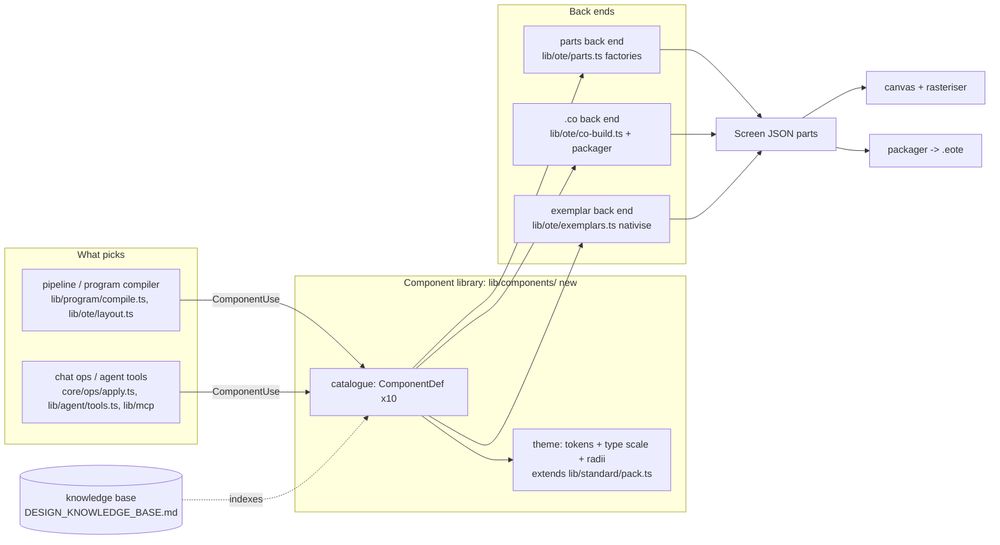

# Design B: better-looking screens (a component library the generator and the agent pick from)

*Audit 2026-11, stream S6. Design only when written. Since built on `main` (a2d2f39): the component catalogue in `web/src/lib/components/catalogue` and components by name from chat, agent and connector (phases 1-4). Phases 5-6 are not built. Measured on branch `audit/2026-11` at 5fd701d.*

Related designs:
- **DESIGN_NESTED_CANVAS.md** (design A) owns the grid unit, the coordinate spaces and the solver. This design
  sizes components on its grid (section 3.2) and does no geometry of its own.
- **DESIGN_KNOWLEDGE_BASE.md** (design C) owns the index. The component catalogue in section 3 is one of the
  kinds of entry it indexes (section 5 says what C must store).

---

## 1. The problem, with evidence

Shaurya says the screens we generate look "sharp and ugly". This section turns that into numbers.

### 1.1 How it was measured

- **Script:** `web/scripts/audit/s6-render.mts`. It draws each screen with the app's own rasteriser
  (`web/src/lib/critic/render.ts`, `screenToPng`), in-process, with no model call: the AI keys are blank, so
  the deterministic fallback plan runs and no Gemini quota is used. For each screen it records:
  - every palette index used, and the resolved hex values;
  - font sizes, stroke widths and rounded rectangles;
  - the share of box edges (left, top, width, height) on the 8 px grid;
  - text-on-fill contrast, and estimated text overflow (0.55 em per glyph);
  - indicator bars written at 0 %;
  - the findings of the project's own geometric critic (`critiqueGeometry`).
- **Run it:**
  ```
  cd web && MONGODB_URI= GEMINI_API_KEY= ANTHROPIC_API_KEY= npx tsx --tsconfig scripts/tsconfig.json scripts/audit/s6-render.mts <outDir> [project.eote ...]
  ```
  PNGs, SVGs and `metrics.json` go to `<outDir>`. Nothing is written into the repo.
  "Render NN" below means the PNG numbered NN from that run; the PNGs stay in the session scratch folder.
- **Inputs: 38 screens, 36 of them from the pipeline.**
  - The tracked fixture `web/src/fixtures/pump-station.screen.json`.
  - `buildDemoProject()` (what `build-demo.mts` packages).
  - The symbol demo (`build-symbol-demo.mts` without the packaging step).
  - `buildFromTags` (`web/src/lib/agent/build.ts`, which is what `build-bar-demo.mts` and the browser run) on four
    tracked samples: `transfer-pump-station`, `tank-farm`, `water-treatment` and `boiler-house`. Panel:
    HMIST6500AWADI, 1024x600.
- **The same script on engineer files.** It was also run on `HMICopilot_Panel1.eote`, `Motor_Drive_Control_4.1.eote`
  and `auto&manua.eote`.
  - Those renders stayed in the session scratch folder. This document reports only counts and patterns from them.
  - `Motor_Drive_Control_4.1.eote` and screen 4 of `HMICopilot_Panel1.eote` carry our own footer ("Generated by
    HMI Copilot"), so they are our output and are not counted as engineer screens.
  - The engineer-built screens are the other eight screens of `HMICopilot_Panel1.eote`. `auto&manua.eote` holds
    the same eight.

### 1.2 What our output is made of (36 pipeline screens)

| Measure | Value | Why it reads as "sharp" or "ugly" |
|---|---|---|
| Rectangles with rounded corners | **0 of 1,765** `<rect>` drawn | Every surface is a hard-cornered box. OTE's Rectangle has a `CornerRadius` (`{Style: 2, TopLeft..BottomRight}`, in a shipped sample: `reference/part_examples.json`, Rectangle corpus). We never write it, and the canvas ignores it when it reads one (section 1.6) |
| Stroke widths on parts | 1 px: 1,297 · 0 px: 700 · 2 px: 81 | Every card, lamp, button, value box, chip and indicator frame has the same 1 px dark (#515151) outline. Nothing has more visual weight than anything else. Shipped Schneider demo objects draw lamps with **no border** (`Border: {Type: 0}`), translucent fills and `Shadow.Enabled` (`reference/part_examples.json`, Lamp from Demo 1.eote) |
| Font sizes | 12 pt: 788 · 13 pt: 327 · 20 pt: 106 · 18 pt: 36 · 24 pt: 5 · 14 pt: 1 | **88 %** of all text is 12 or 13 pt, the pack's touch floor (`pack.ts:136`). On the engineer-built screens all 20 part fonts are 23-26 pt (median 24 pt); in the SVG of their first screen 24 of 27 text runs are 23-30 pt. The shipped Lamp example uses 21 pt |
| Numeric values | NumericDisplay, Consolas (mono) 20 pt, slashed zero, right-aligned in a white 1 px box | A wall of identical "0.0" boxes. In the renders, the value is the most prominent mark on each card even when nothing is wrong |
| Palette | 7-8 indices per screen: #d9d9d9, #f1f1f1, #515151, #030303, #474747, #ffffff, #303030, #971a24 | The palette is right in kind (grey with colour only for alarms), but its two main surfaces barely differ: panel on ground is **1.25:1** |
| Equipment symbols (Path, from the shipped library) | Fill #d9d9d9 on a #f1f1f1 card, or #f1f1f1 on the #d9d9d9 ground: **1.25:1** both ways | The symbol is a white ghost (renders 03, 06, 07, 15). Its 2 px outline, the only thing that should make it visible, is not drawn in the server render (S6-01). The silhouettes are detailed icons (median 69 points, 421 of 474 with curves), drawn at 26-52 px |
| Running vs stopped lamp | Off face #f1f1f1 with a 1 px #515151 border. On face #ffffff with a 2 px #303030 border. Fill contrast **1.13:1** | Correct in principle (an outline change, not green). At 1.13:1 and a 1 px border change, an operator cannot tell RUNNING from STOPPED at arm's length without reading the word |
| Lamps vs push buttons | Same box, same 1 px border, same centred caps label, same size (renders 05, eng4) | A status (NO FAULT) and a command (START) look identical. ISA-101 practice separates "what it is" from "what I can do" by shape |
| Indicator bars written at 0 % | **82** bars on 36 screens | `fillBar` writes `VerticalFill: 0` (`parts.ts:116`), so the canvas draws every bar empty. The canvas's own fallback, half full, exists because "a bar drawn empty reads as broken" (`BasicParts.tsx:14`), but a 0 in the file never reaches it. What shows is an empty white trough with a black band frame (S6-03) |
| Edges on the 8 px grid | mean **48 %** (range 29-75 %) | The pack says grid 8 (`pack.ts:133`). The layout's own zones are off it: HEADER 44, FOOTER 28, MARGIN 12, CARD height 162, TILE 238x100 (`layout.ts:109-118`), plus insets of +34 and +86. Rows look nearly aligned, not aligned |
| Distinct left edges per screen | mean 39 | Card insets (+12), lamp insets, indicator insets (+8) and value boxes each start their own column |
| Estimated text overflow | 115 TextBoxes on 36 screens | Mostly navigation chip labels. With 15 screens a chip is 60 px wide (`layout.ts:298`) and a 13-character screen name needs about 86 px at 12 pt, so labels run into the next chip (render 16). On the process view a callout label ran under its value box ("Pump 102 hour…", render 06) |
| Geometric critic (`critiqueGeometry`) | 9 of 36 screens score 1.0-1.8 of 5, all for `geom.overlap` | A level 2 card's 52 px symbol overlaps its first analogue indicator by 52x16 px whenever the unit has no run or fault lamp (S6-04). `geom.symbolInvisible` fired **0** times: it trusts the 2 px outline that the PNG does not draw |
| Screen height spent on chrome | header 44 + nav 32 + footer 28 + alarm band 148 = **252 of 600 px (42 %)** | ISA-101 summaries give 80-85 % of the screen to the working area. On every level 2 screen with three cards, the body between the cards and the alarm table is empty: 180 px in renders 03 and 08. The alarm table's #515151 header bar is the darkest, heaviest object on a screen with no alarm |
| Raw intent as title | "transfer pump station, with a faceplate for PMP_101" | Lower case, sentence-length. The fallback plan titles the screen with the request text |

### 1.3 Side by side with the engineer's own screens (patterns only)

Measured on the eight engineer-built screens (render numbers below refer to the PNGs in the session scratch folder) of `HMICopilot_Panel1.eote` (1280x800). Counts only; no text is
reproduced.

| | Engineer screens | Ours |
|---|---|---|
| Ground | White canvas, no cards, no panels | Grey ground, lighter cards, 1 px frames everywhere |
| Text | 23-30 pt regular-weight sans, labels under or beside the object | 12-13 pt, bold card titles, caps lamp text |
| Controls | Large round push buttons (about 145 px) from Pro-face Compound Objects: dark grey disc, lighter ring, label inside | Rectangular Switch, same look as a lamp |
| Analogue values | Donut arc gauges (Arch parts in a CO) and segmented vertical bar graphs (BarGraph COs), in saturated hues | Thin 12 px bar with a frame on it, drawn empty |
| Density | 0 to 10 parts per screen (one screen is carried whole). One screen gathers the others through ContentDisplays | 25 to 100 parts per screen (mean 71) |
| Part types | `CompoundObject` on 5 of 8 screens; NumericDisplay, TextBox, ContentDisplay | Rectangle 876, TextBox 884, Switch 352, Lamp 132, Path 123, NumericDisplay 111 |
| Strokes | 1 px on value boxes only; most COs have no outline | 1 px on everything |

The engineer screens are not ISA-101 either: they use saturated green, cyan and brown on white for normal
values. So the target is not "copy the engineer". It is:
- the engineer's **scale and calm** (big text, few objects, large touch targets, native COs);
- with the **colour discipline** ISA-101 asks for and our pack already encodes.

### 1.4 The real HMI photos (patterns only)

`images of real hmi/` holds six HEIC photos. They were converted to PNG in the session scratch folder only, with
`pillow-heif` in a venv, by a script kept in scratch.

**No photo shows an operator screen.** What they show, as patterns:
- **One photo is the panel itself, showing its firmware's download-in-progress screen.** The system UI is a dark
  ground with white bold sans text and one saturated blue accent (a progress ring and a bar).
- **The panel is a landscape, wide-format touch panel behind glossy glass.** The photos show strong reflections
  of ceiling lights. That argues for high-contrast marks, large text and large touch targets, and against
  hairlines and low-contrast greys such as our 1.13:1 and 1.25:1 pairs.
- **It is mounted at roughly chest height on a training rig.** Viewing is at arm's length, touch only.
- **The other photos are the rig's hardware and a placard.**
  - Hardware: breakers, a power supply, a PLC, a network switch, a variable-speed drive and a motor.
  - The placard describes the rig's job: start, stop and set the speed of one motor through a drive, and watch
    the drive's readings.
  - So the first screen this product must make look good is a **single-drive motor control screen**. That puts
    the motor, a speed setpoint entry, drive readings and command buttons first in the library (section 3).

### 1.5 Pro-face / OTE compound objects available

- **No OTE editor is installed on this machine.**
  - `C:\Program Files\Schneider Electric` is empty.
  - `C:\Program Files (x86)\Schneider Electric` holds only drivers, the licence manager and the updater.
- **One OTE library file is present: `C:\ProgramData\Schneider Electric\EcoStruxure Operator Terminal Expert\4.4.20.0\CompoundObjects\COs.pkg`**
  (88,627 bytes). Read by a scratch script, it holds **14 Schneider COs**, matching `docs/CO_FORMAT.md:11`:
  - Gauge_10/20/100/200: two `Arch` parts. Exposed: CurrentValue, Min, Max, InnerRadius, Colors.
  - BarGraph_Horiz/Vert_10/20/30/40/50: a `Path`, or a `Rectangle` with FillLevel. Exposed: CurrentValue, Min,
    Max, Colors. The number is the segment count.
- **The 21 Pro-face COs that `docs/CO_FORMAT.md:12` lists** (lamps, switches, numeric displays, circle and bar
  graphs, from a downloaded se.com zip) are **not on this machine**. Their placed instances are only visible
  through `HMICopilot_Panel1.eote`, as described in 1.3.
- **The tracked `demo_objects/*.co` are ours**, all reading back through the app's reader:
  - TankLevel: Path bar.
  - PumpSpeed: two Arch.
  - FlowTile: two Rectangles.
  - LevelTile: two Rectangles, TextBox and NumericDisplay, built from nothing by `co-build.ts`.
  - The licensed editor accepted FlowTile and PumpSpeed (`demo_objects/IMPORT_TEST.md`, 16 Oct 2026).
- **`web/src/lib/ote/graphics-index.json` (gitignored)** has the shape `{ symbols: [{ name, category, width,
  height, Commands, Points, d }] }`.
  - 474 symbols, all under one top category of icons.
  - Subcategories: General 276, Valves 29, Arrows 28, Air ducts 25, Fans 22, Pipes 19, Air conditioners 17,
    Pumps 16, Mixing 15, Temperature 12, Weather 9, Tanks 4, Air compressors 2.
  - There is **no motor category**. Each symbol is **one filled silhouette with detail cut out (evenodd)**. These
    are pictorial icons, not ISA-101's simplified 2D outlines.

### 1.6 Defects found while measuring

Full entries are in `SCRATCH\notes-S6.md` section E. Summary:

| Id | Severity | What | Proof |
|---|---|---|---|
| S6-01 | P2 | The server rasteriser draws every stretched vector part (Line, PolyLine, Polygon, Bezier, Path symbol) with a hairline: resvg ignores `vector-effect="non-scaling-stroke"` (`Shapes.tsx:59`, `GraphicObject.tsx:79`). A 2 px black line comes out with its darkest pixel at 246/255. The critic, `view_screen` and the MCP render see screens with Lines missing and symbols without outlines | `web/scripts/audit/s6-server-render-strokes.test.ts` |
| S6-02 | P3 | The screen paper is a CSS `style="background"` (`StaticScreen.tsx:107`), which resvg does not paint. Every pixel no part covers is transparent: 17 % of the fixture's PNG | same test file |
| S6-03 | P3 | Generated bars are written at 0 % (`parts.ts:89,116`), so the canvas and the PNG draw them empty, against `BasicParts.tsx:14` | measured: 82 bars on 36 screens |
| S6-04 | P2 | A level 2 card's symbol overlaps its first indicator when the unit has no lamps (`layout.ts:454` vs `layout.ts:511`) | `web/scripts/audit/s6-card-symbol-overlap.test.ts` (18 overlaps) |
| S6-05 | P3 | `Rectangle.CornerRadius` is carried but never drawn (`BasicParts.tsx:31-38`) | measured: 1 per engineer project |

### 1.7 What the research says good looks like

All URLs were fetched or searched on 2026-11-04. ANSI/ISA-101.01-2015 itself and the Hollifield handbook are
paywalled. What follows is from summaries and vendor guides, marked as such.

- **Neutral ground, colour only for abnormal.**
  - "Use a neutral grey (#D9D9D9 or similar) background. Reserve bright colours only for abnormal situations"
    ([industrialmonitordirect, ISA-101 colour strategy](https://industrialmonitordirect.com/blogs/knowledgebase/isa-101-high-performance-hmi-design-principles-color-strategy)).
  - "Muted, neutral low-contrast light gray (Munsell N7 to N8 / #D0D0D0)". "90% of screen pixels consist of
    neutral grays". "Saturated Red, Yellow, Orange, and Magenta are strictly locked to alarm priority indications"
    ([ISA-CAP study guide, ISA-101 summary](https://open-exam-prep.com/study-guides/isa-cap/system-design-hmi-alarms-enterprise/hmi-design-isa101)).
  - The ASM Consortium guidelines aim at "a color scheme that enhances operator performance" rather than
    attractive displays. Light grey DCS backgrounds are the common example. "Applying a new palette alone does
    not make a system compliant"
    ([Control Engineering on the ASM 2nd edition](https://www.controleng.com/creating-an-asm-compliant-hmi-goes-deeper-than-screen-color-selection/);
    [automation.com](https://www.automation.com/en-us/articles/2013-2/asm-publishes-2nd-edition-of-hmi-design-guidelines)).
- **State by shape and fill, not hue.**
  - "Color does not denote state." Running pumps are dark grey filled, stopped ones open outlines, optionally
    with R/S letters (ISA-CAP guide, above).
  - "The equipment state's color selection must depend on additional appearance features, such as Fill, Shape,
    or Text". Off or stopped is grey #9E9E9E, on or running near-white #FCFCFC, out of service #D2D2D2
    ([Tatsoft FrameworX HP-HMI how-to](https://docs.tatsoft.com/display/FX/High+Performance+HMI+Compliance+How-to)).
  - "High performance HMI design refrains from coloring equipment when the equipment is in a state of fault."
    Use an alarm indicator next to it instead
    ([Inductive Automation, HP-HMI techniques](https://docs.inductiveautomation.com/docs/8.1/ignition-modules/vision/common-tasks-in-vision/high-performance-hmitechniques)).
- **Alarm indicator = shape + colour + number, shown only when active.**
  - "A critical seized-motor alarm will display as a red rectangle with the number 1". A high-priority alarm "as
    a yellow triangle with the number 2" (Inductive Automation, above).
  - The ISA-CAP guide gives P1 red square, P2 orange triangle, P3 yellow circle, with flashing "strictly reserved
    for unacknowledged alarms".
  - The sources disagree on the shape order. Section 6 asks Shaurya to choose.
- **Analogue first.**
  - Each bar shows the range, a normal band, a setpoint notch, the value and alarm limit ticks. Similar variables
    are normalised so a deviation shows as a notch. Sparklines sit beside critical variables (ISA-CAP guide).
  - Analogue indicators display "the span of an instrument, along with abnormally high and low values"
    ([Emerson white paper, via search summary](https://www.emersonautomationexperts.com/?p=55403)).
  - Hollifield on what the HMI is for: "An effective HMI gives the operator better situational awareness". The
    same article recommends grey backgrounds, limited colour and embedded trends
    ([Control Global, The Ultimate HMI](https://www.controlglobal.com/articles/2011/the-ultimate-hmi)).
- **Hierarchy and frame.**
  - Four levels: plant overview with no direct control, unit overview (the primary workspace), equipment detail,
    diagnostics.
  - A fixed header and footer, with permanently visible navigation tabs preferred to menus, and every display
    reachable "within about two clicks" (ISA-CAP guide; Tatsoft).
- **Not found in any free source:** ISA-101's own font sizes and touch-target sizes. The summaries say a style
  guide must define them. Section 3.2 derives ours from the panel and states it as an assumption.

---

## 2. The design

### 2.1 What changes, in one paragraph

- **Today, three places draw equipment, each its own way:**
  - the generator's cards (`layout.ts` `drawCard`, `detail`, `tile`);
  - three composites (`composites/index.ts`: AnalogIndicator, KpiTile, EquipmentSymbol);
  - the agent's `addObject`, which places any of 27 part types (plus the 3 composites) and recolours with 22 named hues (`core/ops/ops.ts:46-69`).
- **This design replaces those with one component library.** Each component is a typed definition with:
  - variants;
  - sizes on the grid of DESIGN_NESTED_CANVAS.md;
  - the operating states it shows;
  - the semantic colour tokens it may use;
  - one or more OTE back ends: plain parts, which open today, or a `.co` compound object.
- **The generator and the agent pick a component, a variant, a size and the tag roles. They never pick a colour,
  a font or a coordinate.**
- **Looks live in a theme** (the Standard pack, extended). Today's flat 1 px boxes become a quiet two-step grey
  hierarchy with weight on what matters: larger type, rounded corners, no outline where a fill step says the
  same, distinct shapes for status and command, and alarm colour only on alarm indicators.

### 2.2 Visual rules the theme enforces

Each rule answers a measured problem from 1.2.

| # | Rule | Fixes | Enforced by |
|---|---|---|---|
| V1 | Two surface steps in colour set 4: ground #d9d9d9 (index 11) and field #ffffff (index 21), 1.41:1. Cards are no longer boxes: a group is a heading plus spacing (the engineer screens draw no cards either). A third, mid-grey tier is not in colour set 4 (it has nothing between #d9d9d9 and #515151); it needs a packed colour or a project colour set with one (Q2). Today's card on ground is 1.25:1, which reads as neither one surface nor two | 1.25:1 panel on ground | token table, plus a lint rule: adjacent surface tokens at least 1.4:1 |
| V2 | No outline where a fill step or spacing already separates. Cards, tiles and chips lose their 1 px border; value fields keep a 1 px inset line; only focus or selection and alarm get heavy strokes | 1,297 identical 1 px strokes | component definitions |
| V3 | Corner radius per role: panel 4, field 2, button 6, round button 50 %, alarm indicator 0. Written as `CornerRadius` | 0 of 1,765 rounded | the Rectangle back end writes `CornerRadius`; the canvas draws it (S6-05) |
| V4 | Type scale from the panel's density class (3.2), never below the floor. Three sizes per screen: label, value, title. Values are proportional sans, tabular figures if the font has them, not Consolas | 88 % at 12-13 pt; mono slashed zeros | `TypeScale` in the theme |
| V5 | Running vs stopped differs by **fill and shape**, not by a 1 px border change. Running: dark fill (#303030, index 12) with a white glyph, 13.2:1. Stopped: outline-only shape on the panel. Optional R/S letter. Equipment is never painted in alarm colour | 1.13:1 lamp faces | state table per component (3.4) |
| V6 | Commands look pressable, statuses do not. A command is a raised, rounded button with an action verb. A status is a flat pill or a glyph on the equipment | lamps and buttons identical | separate components (StatusTile vs CommandButton inside Motor/Pump/Valve) |
| V7 | Alarm indicator = shape + colour + priority number, beside the object, drawn only while active. It is the only saturated colour on a normal screen, and always has a 1 px ink outline: P3 yellow on the ground is only 1.32:1 without it | alarm colour on lamp faces; no priority shape | AlarmIndicator sub-part, lint `colour.abnormalOnly` |
| V8 | Analogue first: a bar or gauge shows range, normal band, alarm limits and value, with design-time fill at the band's middle, not 0 | 82 empty bars | the bar back end writes a design value (S6-03) |
| V9 | Symbols are simplified 2D outlines drawn by us (Ellipse, Polygon, Path), 2 px line on panel, not the pictorial icon library. The library icon is an opt-in variant | 1.25:1 ghost icons | Pump, Valve, Motor, Tank definitions |
| V10 | Chrome is at most 20 % of the panel height. The alarm summary becomes a one-line AlarmBanner (latest alarm plus counts) that opens the alarm screen; the full table lives on its own screen | 42 % chrome | NavBar and AlarmBanner sizes |
| V11 | Everything snaps to the scene grid (4 px, DESIGN_NESTED_CANVAS.md §2.4). Component outer sizes are multiples of 8 px (2 units). Inner padding is one unit | 48 % on grid | sizes in definitions; the solver (design A) |
| V12 | Titles come from the plan's screen title in Title Case, never the raw request | raw intent as title | `layout.ts` `chrome` |

### 2.3 Where the library sits



- **One expansion function.** `expandComponent(use, box, theme, backend)` replaces `expandComposite`
  (`composites/index.ts:300`) and the card, detail and tile drawing in `layout.ts:407-783`. It returns parts, wires and a
  `ComponentInstance` record. That record is today's `CompositeInstance` (`store/types.ts:242`), extended with variant,
  size and state.
- **Back end choice per project:**
  - `exemplar` when the opened project has an object of that kind. This is what `exemplars.ts` already does for
    push buttons, toggles, entries, readings and statuses, so the house style wins.
  - Otherwise `co`, when the project allows compound objects and the component has a `.co` back end.
  - Otherwise `parts`.
  - All three draw from the same definition, so the canvas preview and the export agree. Today a nativised part
    is drawn as ours but written as the engineer's (`exemplars.ts:16-19`). Section 5 lists this as risk R4.

---

## 3. The component library

### 3.1 Data structures

These types are new, in a new module `web/src/lib/components/`. Every colour is a token name that the theme
resolves to a palette index: the agent and the generator never see an index or a hex value.

```ts
/** The ten components. "StatusTile" is a state tile; "Gauge" and "Bar" are the two analogue forms. */
export type ComponentKind =
  | "Tank" | "Pump" | "Valve" | "Motor" | "Trend" | "Gauge" | "Bar"
  | "AlarmBanner" | "NavBar" | "StatusTile";

/** Size on the scene grid. Outer sizes are multiples of 8 px (2 grid units, DESIGN_NESTED_CANVAS.md §2.4). */
export type SizeName = "S" | "M" | "L";

/** How dense the panel is: picks the type scale and the size table. Derived from the panel, never asked. */
export type Density = "compact" | "regular" | "large"; // 320x240 | 640x480..1024x600 | 1280x800 and up

/** Operating states a component can show. Not every component shows every state. */
export type OpState =
  | "running" | "stopped" | "opening" | "closing" | "open" | "closed"
  | "manual" | "auto" | "interlocked" | "disabled" | "unknown";

/** ISA-18.2 order, highest first. Shown by an AlarmIndicator beside the component, never by repainting it. */
export type AlarmPriority = 1 | 2 | 3 | 4;

/** Semantic colour roles. The theme maps each to a palette index of the project's colour set. */
export type Token =
  | "ground" | "field" | "line" | "ink" | "muted" | "faint"
  | "equipmentLine" | "equipmentRunning" | "equipmentStopped" | "equipmentDisabled" | "onDark"
  | "processValue" | "normalBand" | "alarmLimit" | "setpoint"
  | "alarmP1" | "alarmP2" | "alarmP3" | "alarmP4" | "onAlarm"
  | "commandFace" | "commandPressed" | "selected"
  | "trend1" | "trend2" | "trend3" | "trend4";

export interface TypeScale { label: number; value: number; title: number; small: number } // pt, all >= floor
export interface Radii { panel: number; field: number; button: number; indicator: number } // px, 0 = square

/** The Standard pack grows a theme; tokens become semantic, rules stay as they are (lib/standard/pack.ts). */
export interface Theme {
  colorSet: number;
  tokens: Record<Token, number>; // palette index per role
  type: Record<Density, TypeScale>;
  radii: Radii;
  stroke: { hairline: 1; equipment: 2; focus: 3 };
  touchMin: Record<Density, number>; // px, smallest pressable box
  grid: { unit: 4; module: 8 }; // must equal design A's scene grid
}

/** A tag role a component needs, in lib/plant/classes.ts vocabulary ("running", "fault", "level", "setpoint"). */
export interface RoleSlot { role: string; dataType: "BOOL" | "INT" | "REAL" | "STRING"; required: boolean }

/** What OTE gets for this component. */
export type Backend =
  | { kind: "parts" } // plain parts from lib/ote/parts.ts, opens today
  | { kind: "co"; definition: string; spec: string } // a .co built by co-build.ts from a spec in this repo
  | { kind: "exemplar"; exemplar: "pushbutton" | "toggle" | "entry" | "reading" | "status" }; // exemplars.ts

export interface ComponentDef<P> {
  kind: ComponentKind;
  variants: readonly string[];
  /** Outer box per size, at density "regular"; other densities scale by the type ratio and re-snap. */
  sizes: Record<SizeName, { width: number; height: number }>;
  states: readonly OpState[];
  /** Whether an AlarmIndicator slot exists, and which corner it takes. */
  alarmSlot?: "topLeft" | "topRight";
  roles: readonly RoleSlot[];
  /** The only tokens its expansion may use: the lint checks this. */
  tokens: readonly Token[];
  /** Label, units, range, normal band, limits, decimals... */
  props: import("zod").ZodType<P>;
  /** In preference order. */
  backends: readonly Backend["kind"][];
  /** Pure: parts + wires. Every box it returns is on the grid. */
  expand(use: ComponentUse<P>, box: Box, theme: Theme, backend: Backend): Expanded;
}

/** What the generator and the agent produce. No coordinates, no colours, no fonts. */
export interface ComponentUse<P = Record<string, unknown>> {
  kind: ComponentKind;
  variant: string;
  size: SizeName;
  /** role -> tag, e.g. { running: "PMP_101_RUN", fault: "PMP_101_FLT", speed: "PMP_101_SPD" } */
  tags: Record<string, string>;
  props: P;
  /** Where, in design A's terms: a region, an anchor and a side, or a slot the compiler chose. */
  place: { region?: string; anchor?: string; side?: string };
}

/** The store record: today's CompositeInstance (store/types.ts:242) plus variant, size and back end. */
export interface ComponentInstance {
  id: string;
  kind: ComponentKind;
  variant: string;
  size: SizeName;
  name: string;
  screenId: string;
  partIds: string[];
  use: ComponentUse;
  backend: Backend["kind"];
}
```

`Box` and `Expanded` are the existing types (`lib/ote/parts.ts` `Box`, `lib/composites/index.ts` `Expanded`).

### 3.2 Grid, sizes and type

- **Grid.** The scene grid is DESIGN_NESTED_CANVAS.md's: **4 px unit** (§2.4). Components use an **8 px module**
  (2 units):
  - outer sizes are multiples of 8;
  - padding is 4 or 8;
  - gaps between components are 8 or 16.
- **Conflict to settle.** `pack.ts:133` says `grid: 8`, and `composites/index.ts:63` snaps to 8. Design A says 4
  for snapping. They are compatible only if the pack's `grid` means the sizing module and design A's unit the
  snap. Q1 asks Shaurya to confirm. Until then, this design treats 4 as the snap and 8 as the module.
- **Density and type scale.** These are assumptions, because ISA-101's own numbers were not found in a free
  source (1.7). They are anchored on the engineer's 24 pt at 1280x800, the shipped Lamp's 21 pt, and the pack's
  12 pt floor.

| Density | Panels | label | value | title | small | touch min |
|---|---|---|---|---|---|---|
| compact | 320x240 | 12 | 14 | 14 | 12 | 32 px |
| regular | 640x480, 800x600, 1024x600 | 14 | 20 | 18 | 12 | 40 px |
| large | 1280x800 and up | 18 | 24 | 24 | 14 | 48 px |

- **The rig's panel is not in the generator's list.** The rig's project is 1280x800 (`HMICopilot_Panel1.eote`
  Target), but `PANELS` (`backend/panels.ts:30-34`) has no 1280x800 entry. The generator can target the rig only
  through a provisional panel value. Q6.

### 3.3 Theme tokens on colour set 4 ("Green-Simple", `palette.ts:11-29`)

| Token | Index | Hex | Use | Contrast |
|---|---|---|---|---|
| ground | 11 | #d9d9d9 | screen background | n/a |
| field | 21 | #ffffff | value fields, banner, nav bar, trend plot, bar track | 1.41 on ground |
| line | 22 | #515151 | field inset line, pipes, scale ticks | 5.6 on ground |
| ink | 1 | #030303 | text, values | 14.6 on ground |
| muted | 52 | #474747 | units, captions | 6.6 on ground |
| faint | 2 | #f1f1f1 | disabled face; normal band on a bar track | fill only |
| equipmentLine | 22 | #515151 | 2 px outline of a symbol | 5.6 on ground |
| equipmentStopped | 11 | #d9d9d9 | stopped or closed body (= ground: outline only) | the outline carries it |
| equipmentRunning | 12 | #303030 | running or open body, filled | 9.4 on ground |
| equipmentDisabled | 2 | #f1f1f1 | out-of-service body, with a muted "OOS" | fill only |
| onDark | 21 | #ffffff | glyph on a running body | 13.2 on #303030 |
| processValue | 12 | #303030 | bar fill, gauge arc, sparkline | 13.2 vs field |
| normalBand | 2 | #f1f1f1 | band painted on the bar track, behind the fill | 13.2, 8.2, 3.7, 9.3 on field |
| alarmLimit | 1 | #030303 | limit ticks on bar and gauge | n/a |
| setpoint | 46 | #1146b4 | setpoint notch and entry border: the one cool hue, never an alarm hue | 5.8 on ground, 8.2 on field |
| alarmP1 | 55 | #971a24 | priority 1 indicator | 6.0 on ground, plus ink outline |
| alarmP2 | 44 | #cf7c00 | priority 2 | 2.3 on ground, plus ink outline |
| alarmP3 | 18 | #ffff58 | priority 3 | 1.3 on ground, ink outline required |
| alarmP4 | 50 | #826db7 | priority 4 | 3.1 on ground, plus ink outline |
| onAlarm | 21 or 1 | white on P1 and P4; ink on P2 and P3 | priority number | 8.4 white on P1; 6.4 ink on P2 |
| commandFace | 21 | #ffffff | raised button face, 2 px line border, radius 6 | 1.41 on ground, plus border |
| commandPressed | 12 | #303030 | pressed or latched | inverted |
| selected | 12 | #303030 | current nav tab: filled dark, white text | inverted |
| trend1..4 | 12, 46, 33, 52 | #303030, #1146b4, #009a3a, #474747 | trend pens: dark, blue, green, grey; never an alarm hue | 13.2, 8.2, 3.7, 9.3 on field |

- **Existing pack tokens keep their indices.** `ground`, `ink`, `muted`, `line`, `white`, `equipmentFill`,
  `equipmentLine`, `runningLine`, `alarmP1..4`, `onAlarm`, `pressedFill` and `pressedInk` stay as they are. The
  new names are aliases, so `applyPack` and the lint keep working while the generator moves over.
- **Two values change:**
  - the card `panel` tier is dropped (V1);
  - running becomes a fill (`equipmentRunning`), not only `runningLine`. The pack comment "Running or open is an
    outline change, never a fill" (`pack.ts:39`) is reversed on purpose. ISA-101 summaries use a dark fill for
    running and an outline for stopped (1.7), and an outline-only change measured 1.13:1.
- **Trend pens change.** Today's channels are GREEN, AMBER, BLUE, RED, TEAL, DARK_GREY (`parts.ts:421`). Two of
  those (amber and red) are alarm hues, and amber on white is 2.0:1.

### 3.4 What OTE can be given, today

Each component maps onto three groups of parts:

| Group | Part types | Status |
|---|---|---|
| **A. Proven** | Rectangle (with `Animation.FillLevel`), TextBox, Lamp, NumericDisplay, Switch (bit operation, and screen change OperationType 4), N-StateLamp, StringDisplay, ToggleSwitch, BarScale, Pipe, DateTimeDisplay, TrendGraph, BlockTrend, AlarmSummary, Path | The generator has a factory in `lib/ote/parts.ts` and writes them today. A generated project with them opened in OTE 4.4 (`docs/SOLUTION.md:306`, `demo_project/OPEN_TEST.md`). Scale converters for bars are written (`converters.ts`) |
| **B. Read and written, no factory** | Ellipse, Line, PolyLine, Polygon, Bezier, Arc, Pie, Arch, Doughnut, ContentDisplay, ClipArt, Image | In `PART_TYPES` (`schema.ts:910-938`); each has a real example from a shipped project in `reference/part_examples.json`. A factory built from that example is low risk, but **a generated one has not been opened in OTE**: phase 1 checks it on the bench (`web/scripts/ote-bench.ps1`) |
| **C. Inside a .co** | Arch gauges and Path/Rectangle bar graphs (the 14 shipped Schneider COs); our 4 `demo_objects/*.co` | `co-build.ts` builds a .co from a spec; the licensed editor imported two of ours (`demo_objects/IMPORT_TEST.md`). Scripts are not generated (`docs/CO_FORMAT.md` "Still open") |

Two properties matter and are **not proven** for generated output (Q3, Q4):
- **`CornerRadius` on a Rectangle.** It exists in a shipped sample.
- **`Visibility` bound to a tag** (through an Expression converter). Pro-face COs bind it to a local variable
  (`co-look.ts:19-25`).

The design works without either. Where it needs one, the "lost" column says what goes.

### 3.5 The ten components

Sizes are at density "regular" (1024x600), in px, outer box including the label row. Every size is a multiple of
8. "Indicator" means the AlarmIndicator of 3.6.

#### Tank
| | |
|---|---|
| Variants | `vertical` (flat top, rounded corners), `coneBottom`, `horizontal` |
| Sizes | S 64x96 · M 96x144 · L 128x192 |
| States | normal · level alarm (indicator, top-right) · disabled (body `equipmentDisabled`, "OOS") |
| Roles | `level` REAL required · `high`, `low` BOOL optional · `temperature` REAL optional (shown as a callout Bar) |
| Tokens | equipmentLine, equipmentStopped, field, normalBand, processValue, alarmLimit, ink, muted, alarmP1-4 |
| Parts back end | Body: Rectangle with `CornerRadius` 8, 2 px equipmentLine, fill ground; cone: Polygon (group B). Level: inner Rectangle `FillLevel.VerticalFill` bound through a Scale converter (group A, as `fillBar` does), design fill at the band's middle. Normal band: a faint Rectangle behind the fill. Limits: Line ticks at HH/H/L/LL (group B). Value: NumericDisplay + unit TextBox. Label: TextBox. Indicator |
| .co back end | `HMICopilot_Tank`, built by `co-build.ts` from a spec: the LevelTile pattern (`demo_objects/specs/HMICopilot_LevelTile.json`) plus exposed NormalLow, NormalHigh and Label |
| Lost (parts) | One object in OTE (the engineer moves 6-9 parts). Band and limits are fixed at generation: a range change regenerates. Rounded corners until Q3 is answered (square fallback) and S6-05 is fixed |
| Lost (.co) | The project must carry the definition (packager support for adding new definitions: Q5). The canvas look is resolved once at read (`docs/CO_FORMAT.md` "Not yet") |

#### Pump
| | |
|---|---|
| Variants | `centrifugal` (circle + discharge nozzle), `positiveDisplacement` (circle + inner lobe), `withSpeed` (adds a horizontal Bar S under it) |
| Sizes | S 48x64 · M 64x88 · L 88x112 (symbol 32/48/64 square + label row + state badge) |
| States | running · stopped · manual · interlocked · disabled · unknown; fault = P1 indicator |
| Roles | `running` BOOL required · `fault` BOOL · `mode` BOOL (auto/manual) · `speed` REAL · `start`, `stop`, `reset` BOOL commands (faceplate only) |
| Tokens | equipmentLine, equipmentStopped, equipmentRunning, equipmentDisabled, onDark, ink, muted, alarmP1-4, onAlarm |
| Parts back end, v1 (groups A+B, no Visibility) | Symbol: Ellipse + Polygon nozzle, 2 px equipmentLine, fill ground, static. State: an **N-StateLamp badge** under the symbol, radius-free pill, faces: 0 stopped = ground fill, line border, "STOP"; 1 running = equipmentRunning fill, onDark text "RUN"; 2 manual = faint fill, "MAN"; 3 disabled = faint, muted "OOS". Bound to the running tag (or to an INT state word when the class has one). Label TextBox. Indicator top-left |
| Parts back end, v2 (after Q4) | Two Ellipses, outline-only and filled, with `Visibility` bound to the running tag: the body itself fills when running, as ISA-101 summaries draw it; the badge shrinks to a mode letter |
| .co back end | `HMICopilot_Pump`, exposing Running, Fault, Mode, Label. The fill layer is driven by Visibility bindings from `$CO.Running` (needs Q4); no scripts |
| Lost (v1) | The body does not change fill: state is read from the badge beside it. Detailed library pictures are gone by default; `variant: "libraryIcon"` keeps today's Path icon, with its 1.25:1 caveat |

#### Valve
| | |
|---|---|
| Variants | `onOff` (bow-tie), `control` (bow-tie + actuator dome + position Bar), `check` |
| Sizes | S 32x40 · M 48x64 · L 64x88 |
| States | open · closed · opening · closing · manual · disabled · unknown; travel fault or discrepancy = P2 indicator |
| Roles | `open` BOOL · `closed` BOOL (either required) · `position` REAL (control) · `openCmd`, `closeCmd` BOOL |
| Tokens | as Pump, plus processValue for the position Bar |
| Parts back end | Two Polygon triangles + Line stem + Ellipse dome (group B), static outline. State badge: N-StateLamp "OPEN"/"CLSD"/"TRVL"/"MAN"/"OOS" from open+closed (an Expression converter to a state index, or two Lamps when that is not wanted). Position: Rectangle FillLevel horizontal (group A) |
| .co back end | `HMICopilot_Valve`: Open, Closed, Position, Label |
| Lost | As Pump. "Opening/closing" as a half-filled body needs Q4; v1 shows TRVL in the badge |

#### Motor
| | |
|---|---|
| Variants | `plain` (circle with "M"), `withDrive` (motor + drive box + speed Bar + frequency/current callouts), `fan` |
| Sizes | S 48x64 · M 64x88 · L 88x112; `withDrive` M 240x136 · L 320x184 |
| States | running · stopped · manual · interlocked · disabled · unknown; fault = P1 indicator, warning = P2 |
| Roles | `running` BOOL required · `fault` · `ready` · `mode` · `speed`, `frequency`, `current`, `torque` REAL · `speedSetpoint` REAL (entry) · `start`, `stop`, `reset` BOOL |
| Tokens | as Pump, plus processValue, setpoint, commandFace, commandPressed |
| Parts back end | Symbol: Ellipse + TextBox "M" (group B + A). State badge: N-StateLamp as Pump. `withDrive`: Bar components for speed and current (3.5 Bar), a setpoint entry (NumericDisplay with input enabled, `setpoint` border, as `numericDisplay(..., input=true)` already makes). The faceplate adds CommandButtons (3.6) |
| .co back end | `HMICopilot_Motor`; for the rig, **exemplar first**: the rig's project already has Pro-face push-button COs, and `exemplars.ts` clones them for START, STOP and RESET |
| Lost | As Pump. This is the rig's main screen (1.4), so it is the first component to build and bench |

#### Trend
| | |
|---|---|
| Variants | `line` (TrendGraph), `sparkline` (TrendGraph, no cursor labels, small), `block` (BlockTrend) |
| Sizes | sparkline S 96x32 · M 240x120 · L 480x200 (line and block) |
| States | none (data); pens trend1..4 in order |
| Roles | 1-4 REAL tags; optional normal band per pen (drawn as a faint Rectangle behind the plot) |
| Tokens | field, line, ink, muted, trend1-4, normalBand |
| Parts back end | TrendGraph / BlockTrend (group A), `Fill` field, `Border` none, `CursorLabelsEnabled` false for a sparkline. Band: a faint Rectangle behind it, since TrendGraph has no band property we know |
| .co back end | none: a trend is a native part |
| Lost | Band shading inside the plot, limit lines and hiding the axes: no known TrendGraph property does these. The canvas legend draws raw tag names at 9 pt (`DataParts.tsx:293`), below the floor: draw the label instead |

#### Gauge
| | |
|---|---|
| Variants | `arc270`, `arc180` |
| Sizes | S 64x80 · M 96x120 · L 144x168 (dial + value row) |
| States | normal; value in an alarm zone = indicator; the dial is never recoloured |
| Roles | `value` REAL required; props: min, max, normalLow, normalHigh, limits, units |
| Tokens | field (track), normalBand, processValue (value arc), alarmLimit, ink, muted |
| Parts back end | Three Arch parts (group B): track, band (static angles from the props), value arc with `EndAngle` bound through a Scale converter to 0-270 (the shipped Gauge pattern, `docs/CO_FORMAT.md` "A value through a range"). NumericDisplay in the centre, unit TextBox |
| .co back end | The shipped `Gauge_10/20/100/200` (in `COs.pkg`) with Colors set to the tokens, or our `HMICopilot_PumpSpeed.co` |
| Lost (shipped CO) | It exposes only CurrentValue, Min, Max, InnerRadius and Colors: no normal band and no limits. Ours adds them |

#### Bar (today's AnalogIndicator, reworked)
| | |
|---|---|
| Variants | `vertical`, `horizontal`, `deviation` (centre zero) |
| Sizes | vertical S 48x128 · M 64x184 · L 96x240; horizontal S 184x40 · M 240x56 · L 320x64 |
| States | normal; in an alarm limit = indicator beside the value |
| Roles | `value` REAL required · `setpoint` REAL optional; props: min, max, normalLow, normalHigh, HH/H/L/LL, units, decimals |
| Tokens | field (track), normalBand, processValue, alarmLimit, setpoint, ink, muted |
| Parts back end | Track: Rectangle field, radius 2. Band: faint Rectangle. Fill: Rectangle FillLevel bound through a Scale converter (group A, as today), design value at the band's middle (S6-03). Limits: Line ticks (B). Setpoint: small Polygon notch (B). NumericDisplay + unit TextBox. BarScale only at size L |
| .co back end | `HMICopilot_Bar` from a spec (LevelTile plus band and limits); shipped BarGraph_* as a fallback |
| Lost | Shipped BarGraph has no band or limits, and its segments read as decoration |

#### AlarmBanner
| | |
|---|---|
| Variants | `line` (one row: the most urgent active alarm + counts), `table` (today's AlarmSummary, for the alarm screen only) |
| Sizes | line: full width x 32 (regular) / 40 (large) · table: the alarm screen's body |
| States | no alarm (field band, muted "No active alarms", no dark header) · alarms (indicator of the highest priority + its message) |
| Roles | none (system) |
| Tokens | field, line, ink, muted, alarmP1-4, onAlarm |
| Parts back end | Rectangle field band + AlarmSummary sized to one row (group A) + a screen-change Switch over it to the alarm screen (`screenSwitch`, group A) |
| .co back end | none |
| Lost | Per-priority counts need a count per priority. No system variable for it is known (Q7). Until then the banner shows the summary's top row only. Whether AlarmSummary draws well at one row high is unverified in OTE |

#### NavBar
| | |
|---|---|
| Variants | `tabs` (top, up to the number that fit at label size), `tabsMore` (overflow goes to an index screen), `rail` (left, for 9+ screens on large panels) |
| Sizes | height 32 (regular) / 40 (large); tab width = label width at `label` pt + 16, min `touchMin` |
| States | current (`selected` fill, onDark text) · other (field, ink) · pressed |
| Roles | none; the screen list |
| Tokens | field, line, ink, selected, onDark, commandPressed |
| Parts back end | Rectangle field band; per tab Rectangle (radius 4) + TextBox + `screenSwitch` (group A, as `layout.ts` `chrome` does today) |
| .co back end | none (a master screen, when the packager supports one: `docs/ARCHITECTURE_SCREEN_QUALITY.md` §3.7) |
| Lost | Nothing new. It fixes today's overflow: a tab is never narrower than its label; extra screens go to "More" |

#### StatusTile (level 1 overview tile; replaces `tile()` and KpiTile)
| | |
|---|---|
| Variants | `state` (name + state badge), `kpi` (name + value + unit + sparkline), `alarmCount` |
| Sizes | S 120x64 · M 184x96 · L 240x128 |
| States | normal (no colour) · any alarm in the unit = indicator top-right at the highest priority · running/stopped as a badge |
| Roles | the unit's headline reading, running, fault (from `lib/library/machines.ts` headline) |
| Tokens | field, line, ink, muted, processValue, equipmentRunning, onDark, alarmP1-4 |
| Parts back end | Rectangle field radius 4, no border. TextBox name. N-StateLamp badge or NumericDisplay + unit + TrendGraph sparkline. `screenSwitch` over the tile to the unit's level 2 screen |
| .co back end | `HMICopilot_KpiTile` (a later phase) |
| Lost | Nothing compared with today |

### 3.6 Shared sub-parts

**AlarmIndicator**
- One rule for all ten components: it is drawn only while active, sits at the component's `alarmSlot`, shows the
  priority number, and has a 1 px ink outline.
- **Parts v1.** An N-StateLamp with 5 states:
  - state 0: transparent fill, no border, no text (invisible);
  - states 1-4: the priority colour and its number.
  - It is bound to an INT "highest active priority" when the plant model has one. With only a BOOL fault tag, a
    Lamp: Off invisible, On P1 with "1".
- **Lost in v1:** the shape. A lamp face is a box, so every priority is a square. Triangle, circle and diamond
  need Polygon or Ellipse layers with Visibility bindings (Q4). The shape order itself is Q8.

**CommandButton** (inside Motor, Pump and Valve faceplates)
- A momentary Switch (`switchPart`, group A) on `commandFace`, 2 px line border, radius `button` (Q3), at least
  `touchMin` square. The label is an action verb.
- When the project has a push-button exemplar (the rig does), the exemplar back end clones it, as `exemplars.ts`
  does today.

### 3.7 How the generator and the agent choose today, and after

| Who picks | Today | After |
|---|---|---|
| Pipeline, level 1 | `layout.ts:728` `tile()`: a Rectangle + name + one Lamp or NumericDisplay | `StatusTile` (variant from the unit's class headline) |
| Pipeline, level 2 cards | `layout.ts:433` `drawCard`: Rectangle card, Path icon, two Lamps, AnalogIndicator composites | Equipment component (Pump/Valve/Motor/Tank by class) + Bar callouts; no card box |
| Pipeline, level 3 detail | `layout.ts:577` `detail`: Lamps, Switches, ToggleSwitch, entries, AnalogIndicators, TrendGraph | Motor/Pump/Valve faceplate: component at L, CommandButtons, setpoint entry, Bars, Trend |
| Pipeline, process view | `lib/program/compile.ts` with `EquipmentSymbol` composites and `pipeRun` | Same topology (`program/topology.ts`), components at M, pipes on `line` |
| Pipeline, chrome | `layout.ts:266` `chrome`: header 44, chips, footer, AlarmSummary 148 | NavBar + AlarmBanner(line) + Title; ≤ 20 % of height |
| Class to picture | `lib/library/machines.ts` names a shipped symbol per class; `symbols.ts` resolves it | Each class names `{ component, variant }`; the icon stays an opt-in variant |
| Chat ops | `core/ops/ops.ts` `type: PART_TYPES or COMPOSITE_KINDS`, `color: COLOR_NAMES` (22 hues); `core/ops/apply.ts:540` `addObject`, `:484` `addEquipment` (uses `equipmentCard`), `:755` `setColor` | `type` adds `ComponentKind`, plus `variant` and `size`; `addEquipment` expands the class's component; `setColor` takes a `token` |
| Agent | `lib/agent/tools.ts` edits project files (`json_set`, `clone_object`, `compound_objects`), `view_screen` renders | A `components` tool (the catalogue, from design C's index) and `place_component` (expands into the screen file through the same function) |
| MCP (claude.ai) | `lib/mcp/tools.ts` reads and edits | The same two tools, read-only listing first |
| Canvas toolbar | `components/canvas/newPart.ts` TOOLS group "Composites" | Group "Components", one entry per kind; variant and size in the inspector |

---

## 4. What changes in which files

New:
- `web/src/lib/components/theme.ts`: `Theme`, `DEFAULT_THEME` on colour set 4 (3.3), `densityOf(panel)`.
- `web/src/lib/components/catalogue/{tank,pump,valve,motor,trend,gauge,bar,alarmBanner,navBar,statusTile}.ts`
  plus `alarmIndicator.ts` and `commandButton.ts`: one `ComponentDef` each.
- `web/src/lib/components/index.ts`: `COMPONENTS`, `expandComponent(use, box, theme, backend)`,
  `backendFor(project, kind)`.

Changed (all under `web/src`):

| File | Change |
|---|---|
| `lib/standard/pack.ts` | `StandardPack` gains `theme` (semantic tokens as aliases of today's, type scale, radii, touchMin). `rules.grid` is renamed or documented as the 8 px module (Q1). Comment at `:39` reversed (running is a fill) |
| `lib/ote/parts.ts` | Factories `ellipse`, `polygon`, `line`, `arch` built from the `reference/part_examples.json` shapes. `rectangle(..., { radius })` writes `CornerRadius` (after Q3). `fillBar` takes a design value (S6-03). Trend pens from tokens (`:421`). Font size from the type scale, not hard-coded 12/13/20 |
| `lib/composites/index.ts` | Becomes a shim: `AnalogIndicator` maps to `Bar`, `KpiTile` to `StatusTile(kpi)`, `EquipmentSymbol` to the class's component. `COMPOSITE_KINDS` stays readable so stored projects still open |
| `store/types.ts:242` | `CompositeInstance` gains `variant`, `size` and `backend`; old records read as defaults |
| `lib/ote/layout.ts` | `chrome` (`:266`), `drawCard` (`:433`), `detail` (`:577`) and `tile` (`:728`) compose components. Zones move onto the grid (`:109-118`). `ALARM_BAND` 148 becomes the 32 px banner. Fixes S6-04 by construction (components own their boxes) |
| `lib/program/compile.ts` | The process view places components instead of `EquipmentSymbol`. The KPI band uses `StatusTile` |
| `lib/program/regenerate.ts` | Keys of component parts follow the component's stem, as composites do today (`layout.ts:216-221`), so regeneration still finds them |
| `lib/library/machines.ts` | Each class adds `component: { kind, variant }` beside its symbol hint |
| `core/ops/ops.ts` | `type` enum adds `ComponentKind`. New `variant` and `size`. `color` stays for engineers who name a hue, plus `token` for the model |
| `core/ops/apply.ts` | `addObject`'s composite branch (`:573-597`) calls `expandComponent`. `addEquipment` (`:484-539`) expands the class component instead of `equipmentCard`. `setColor` (`:755`) accepts a token |
| `lib/ai/converse.ts` | The op description (`:460`) and the prompt list components, variants and sizes from the catalogue (or design C's index), not part types |
| `lib/agent/tools.ts` | New `components` and `place_component` tools; `view_screen` unchanged |
| `lib/mcp/tools.ts` | The same two tools for the connector |
| `lib/ote/exemplars.ts` | Its five kinds become the components' `exemplar` back end. The canvas draws the exemplar's look (co-look), so preview and export agree (R4) |
| `lib/ote/packager.ts` | The `.co` back end adds a definition under `CompoundObjects/<id>/` when a component instance needs one (Q5). Phase 5 only |
| `lib/standard/lint.ts` | New rules: `component.tokens` (a component's parts use only its tokens), `type.floor` per density, `touch.min`, `surface.contrast` (adjacent surface tokens ≥ 1.4:1) |
| `lib/critic/geometry.ts` | `geom.symbolInvisible` checks the drawn outline, not the declared Thickness. After S6-01 it can trust the PNG |
| `lib/critic/critic.ts` | `checklist()` reads the theme |
| `components/canvas/parts/BasicParts.tsx` | Draw `CornerRadius` (S6-05) |
| `components/canvas/parts/Shapes.tsx`, `GraphicObject.tsx` | S6-01: map points into the box in code instead of a stretched nested viewBox, so a plain stroke is right in the browser and in resvg alike |
| `components/canvas/StaticScreen.tsx` | S6-02: paint the paper as a `<rect>` |
| `components/canvas/parts/DataParts.tsx:293,324` | The trend legend uses the pen's label at the floor size, not the tag at 9 pt |
| `components/canvas/newPart.ts`, `components/library/LibraryPanel.tsx` | Toolbar and library list the components |

Not changed: the `.eote` writer's output format for the parts it already writes, the OAuth and MCP wire formats,
and Vercel, Supabase or Mongo settings. The `.co` back end adds definitions to a project, which is new writer
output. It is flagged "needs Shaurya" in Q5.

---

## 5. Risks

| # | Risk | Likelihood / impact | Mitigation |
|---|---|---|---|
| R1 | OTE refuses or redraws a generated part of group B (Ellipse, Polygon, Line, Arch) or `CornerRadius` | medium / high | Phase 1 benches each new factory in the licensed editor before any component uses it. v1 of every component works with group A plus a square fallback |
| R2 | A project on a colour set other than 4 | medium / medium | Tokens resolve by role per colour set, as `applyPack` does by hue and lightness. Packed colours (`ColorIndexEnabled: false`, `palette.ts:85-87`) only with Shaurya's yes (Q2) |
| R3 | Existing projects hold `CompositeInstance` records and part keys from today's layout | high / medium | The shim reads old kinds. Regeneration matches by the stem the composite already uses. A test opens a stored project from before the change |
| R4 | Preview and export differ: the exemplar back end writes the engineer's object while the canvas draws ours (true today, `exemplars.ts:16-19`) | high / medium | Draw the exemplar through co-look, so what you see is what OTE gets. Test: the PNG of the parts back end and of the exemplar back end are compared per component |
| R5 | "Better looking" is taste: the rig's engineer uses saturated colour on white (1.3) | medium / medium | The theme is part of the pack. A customer pack can be the engineer's style. The default stays ISA-101 because it is the published practice (1.7). Q9 |
| R6 | The model ignores the catalogue and keeps adding raw parts | medium / low | Op schema: components first. `coerceTurn` already drops coordinates (`ops.ts`); lint flags non-token colours on the turn |
| R7 | Fonts: OTE writes `Font.Type.Value "0"` (`parts.ts:28`) and the panel's face is not ours (resvg uses Segoe UI or Noto Sans, `render.ts:80`) | medium / low | Type sizes leave 20 % slack in every text box. The bench screenshots the panel |
| R8 | A component with a `.co` back end needs a compound-object licence on the customer's OTE (`demo_project/OPEN_TEST.md:6-8` says plain-part projects "need no compound-object licence") | unknown / high | Parts back end is the default; `.co` is opt-in per project (Q5) |
| R9 | Larger type means fewer things per screen | high / low | That is intended (density rule V10). The planner's capacity (`layout.ts` `capacityOf`) reads component sizes, so it splits screens instead of cramming |

---

## 6. Phased plan, with tests

| Phase | Size | What | Tests (all in `web/tests`, no network, no key) | Done when |
|---|---|---|---|---|
| 0. Make the picture true | S | S6-01 (strokes in resvg), S6-02 (paper), S6-03 (design-time bar value), S6-05 (CornerRadius drawn) | Move `scripts/audit/s6-server-render-strokes.test.ts` in. Add a CornerRadius render test, and a test that a generated bar renders at its design value | Both s6 tests pass; the vision critic sees what the editor shows |
| 1. Theme and new parts | M | `Theme` in `pack.ts`; factories for Ellipse, Polygon, Line, Arch; `CornerRadius` option | Each factory: schema parse, packager write, reader read-back identical. Theme: every token pair in 3.3 meets its contrast (computed, as `critic/geometry.ts` `contrastRatio` does) | **Needs Shaurya:** a bench project with one of each new part opens in OTE 4.4 and looks as the canvas draws it (`web/scripts/ote-bench.ps1`) |
| 2. Catalogue, parts back end | M | Bar, Motor (plain and withDrive), Pump, Valve, Tank, AlarmIndicator, CommandButton, then Gauge, Trend, StatusTile, NavBar, AlarmBanner | Per component, per variant, per size, per density: every box on the 4 px grid and inside the outer box; `critiqueGeometry` finds no overlap; parts use only the declared tokens; texts ≥ floor; pressables ≥ touchMin; each role tag is wired to the right property (Bar through a Scale converter); packager round trip | The ten render in a gallery screen with no lint finding |
| 3. Generator uses it | M | `layout.ts`, `compile.ts`, `machines.ts` | `s6-render.mts` becomes a test over the four samples: 0 `geom.overlap`, ≥ 95 % of edges on the 4 px grid, no font under the density floor, chrome ≤ 20 % of height, 0 empty bars, palette ⊆ theme tokens, no text overflow by the 0.55 em estimate. Golden SVGs for one screen per level | Shaurya looks at before/after PNGs of the four samples and the rig's drive screen |
| 4. Chat, agent, MCP | S | ops schema, `apply.ts`, `converse.ts`, agent and MCP tools | `coerceTurn` keeps `variant` and `size`; `addObject` of each kind places a valid instance; `setColor` by token; a recorded session ("add a pump for PMP_101 next to the tank") replays to the same parts | The agent places a component with no coordinate and no colour in its call |
| 5. `.co` back end | L | Specs for Motor, Pump, Tank and Bar; packager adds definitions; v2 states after Q4 | co-build round trip; co-look draws the `.co` back end within a pixel tolerance of the parts back end | **Needs Shaurya:** imported into OTE and placed; the state layer switches in the simulator |
| 6. Knowledge base entries | S | Design C indexes the catalogue | A test that the index entries equal `COMPONENTS` (kinds, variants, sizes, roles, tokens), so the two cannot drift | design C's check passes |

Order and sizes: phase 0 can ship alone in the bug-fix stage. Phases 1-3 are the visible change. Phases 4-6 follow.

---

## 7. Open questions for Shaurya

1. **Q1 Grid.** Design A snaps to 4 px; the pack says `grid: 8` (`pack.ts:133`); composites snap to 8. Is 4 the
   snap and 8 the sizing module? This design assumes yes.
2. **Q2 A third grey.** Colour set 4 has no grey between #d9d9d9 and #515151. Do we drop the card tier (this
   design's default)? Or write packed RGB greys (`ColorIndexEnabled: false`), which stop following the project's
   colour set? Or ship a project colour set with a mid grey?
3. **Q3 CornerRadius.** Does OTE 4.4 keep and draw `CornerRadius` on a generated Rectangle (seen only in a 3.4
   sample)? Is there a radius on Switch and Lamp faces?
4. **Q4 Visibility binding.** Can a screen part's `Visibility` be bound to a tag through an Expression converter,
   outside a CO? This decides whether a pump's body can fill when running (v2) or only its badge can (v1).
5. **Q5 Compound objects.** May the packager add new CO definitions to a project? Does a customer need a CO
   licence to open it? This touches the `.eote` writer's output, so it needs Shaurya.
6. **Q6 The rig's panel.** Add 1280x800 to `PANELS` (`backend/panels.ts:30-34`)? Under which model id? The rig's
   project targets it.
7. **Q7 Alarm counts.** Is there an OTE system variable for the number of active alarms per priority, for the
   one-line banner?
8. **Q8 Alarm shapes.** Sources disagree. ISA-CAP guide: P1 square, P2 triangle, P3 circle. Inductive
   Automation: P1 rectangle, P2 triangle. `docs/ARCHITECTURE_SCREEN_QUALITY.md:176`: P1 square, P2 circle,
   P3 triangle, P4 diamond. Which is ours? The customer's alarm philosophy usually decides.
9. **Q9 Whose taste.** The default is ISA-101 grey. The rig's engineer uses saturated colour on white. Should the
   rig's demo use the default pack, or a customer pack in the engineer's style?
10. **Q10 Font.** Which typeface does the panel draw for `Font.Type.Value "0"`? The type scale assumes a
    Segoe-like sans.
11. **Q11 Library icons.** Keep the shipped pictorial icons as an opt-in variant, or drop them from generation
    (they measured 1.25:1)?

---

## 8. Consistency with designs A and C

Checked against the versions on disk at the end of this stream.

- **Grid (design A, DESIGN_NESTED_CANVAS.md §2.4): consistent.** A sets a 4 px unit for new and generated
  screens. This design snaps to that unit and sizes components in 8 px modules (3.2). The only conflict is the
  pack's own `grid: 8` (`pack.ts:133`) and the composites' 8 px snap (`composites/index.ts:63`): Q1.
- **Ids (design C, DESIGN_KNOWLEDGE_BASE.md).** C's example id is `comp:pump.faceplate.l2`. This catalogue's
  natural key is `comp:<kind>.<variant>.<size>`, for example `comp:pump.centrifugal.m`. The faceplate is a
  Pump/Motor/Valve at size L on a level 3 screen, not its own variant.
  - Proposal: C indexes `comp:<kind>.<variant>`, with sizes and states in the entry body.
  - Flagged to the orchestrator: it is not settled here.
- **Emittability (design C, rule 4: "every `comp:*` maps only to emitted `part:*` entries or to a `.co`").**
  Components that use group B parts (Ellipse, Polygon, Line, Arch; 3.4) fail that rule until phase 1 adds their
  factories and the bench proves them. Until then each such entry names a fallback:
  - Pump, Valve, Motor and Tank: a Rectangle body with the N-StateLamp badge (group A);
  - Gauge: the shipped Gauge CO (group C) or a Bar;
  - limit ticks and setpoint notch: thin Rectangles.
